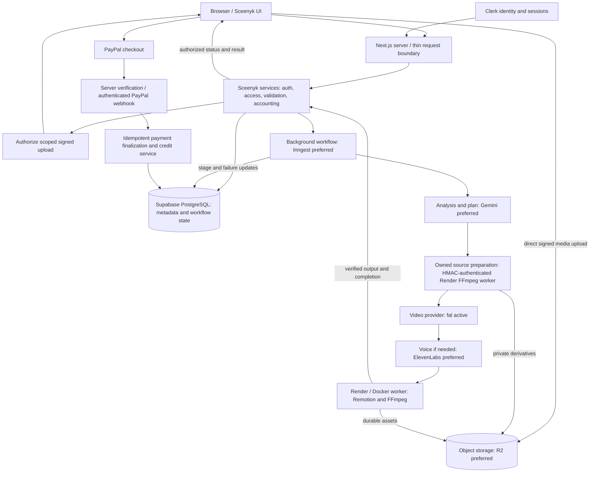

# Architecture Context

## Workspace foundation — Phase 1 (2026-10-18)

Current authorization supersedes earlier documentation-only and landing-only boundaries for this unit. Shared components/workspace presentation serves public guest /create, owned /projects/[id], public /marketplace and its detail/storefront routes through app/(workspace)/layout.tsx. The existing /dashboard protected layout keeps server identity enforcement and wraps Settings, Marketplace management and the new /dashboard/projects page in the same shell. One root auth/theme provider remains authoritative; presentation never grants data access. No backend/domain/schema/provider changes are required.

Dashboard becomes compatibility navigation: the existing authenticated proxy redirects before streaming so browser fragments survive; the page retains a redirect fallback. Default entry redirects to /create; legacy paginated requests go to /dashboard/projects with their page retained. Fragments survive the redirect in browsers; a small Studio client boundary maps #projects/#templates to Projects and #credits to existing Settings billing. Projects reuses existing owner-scoped listing/status services, pagination and cards. Save/free-adoption/paid-recovery actions invalidate the new Projects URL; only their route-cache targets change, with no domain or financial logic changes. The former Templates placeholder remains on Projects for old bookmarks; Templates and Documentation navigation are marked Soon until Phase 2, with no invented feature or dead route.

Desktop navigation has Create, Workspace, Discover, Resources and Account groups, a locally persisted 240px/80px rail and a bottom account menu linking to existing Settings sections. Credits links only to Settings → Credits & Billing. Mobile uses a labeled, focus-managed Sheet with the same navigation/account links. Surfaces reuse semantic theme tokens, official logos and primitives. Marketplace stays public; Settings/cache rules, project ownership, callbacks, payment, credit, payout and Inngest boundaries remain unchanged. Cloud stays paused. Phase 2, full Studio composition and guest draft restoration are separate units. Acceptance is recorded in the tracker.

Current authorized follow-up: only the decorative home gallery is pinned; hero copy is in normal foreground flow, bottom-aligned within the first viewport and scrolling with the story. Mobile/tablet navigation moves to a left Sheet; its real account avatar links to the existing account settings page to avoid overlapping Clerk/Sheet focus traps. Signed-out authentication opens only after the drawer closes. The footer reuses supplied artwork under a contrast treatment. The shared theme now defaults to Dark when no valid preference exists, while preserving saved Light/Dark and explicit System (stored as system); this theme-only cross-app change is expressly requested. Local production/browser/visual acceptance is Complete; deployment remains pending in the latest tracker entry.

## Landing-only presentation implementation (2026-10-17)

The user now authorizes landing-page visual refinement/motion only; the broader redesign is not started by this unit. Home remains server-composed, with local `LandingMotion`/`HeroGallery` client boundaries for one-shot section entrances and fine-pointer transforms. Scoped CSS reuses existing theme tokens. Route-aware `PublicNavbar`/`PublicFooter` in the existing public layout choose new chrome only for `/`, retaining the old public Navbar/Footer on `/create`, Marketplace and owned project routes. Root auth, route guards, private-cache policies and server/domain services remain unchanged. The expressly requested shared Dark default is the only cross-app presentation change; saved Light/Dark and explicit System still work. Static marketing artwork uses original supplied `/images` filenames and Next Image responsive optimization. The illustrated Studio/gallery are labeled concepts; they do not create provider jobs, publish listings or enable unsupported editor/player/newsletter capabilities. Current validation/deployment status is in the tracker. Inngest Cloud remains paused.

## Approved redesign presentation architecture (2026-10-17)

**Approved direction; redesign implementation Not Started.** [The canonical redesign contract](ui-context.md) defines two presentation environments on the same root auth/theme and existing server/domain services: Public / Discovery (Landing, Marketplace, Pricing, Documentation, creator storefronts) and Workspace (Studio, Projects, Library, Settings, creator/account management). Public pages use top navigation and immersive layouts; workspace uses persistent compact large-screen navigation and output-first contextual tools. Studio configuration stays public; private projects, media, account and financial data remain independently authenticated/owned.

Large-screen Studio has **App Navigation | Project / Sources | Preview Stage | Properties**. The Stage receives the most space, with a fixed-height toolbar around 56–64px and preview filling the remainder. Sources means project inputs/imports/media/existing scenes, not Effects. Properties exposes only supported creative controls. Tablet progressively collapses secondary panels. Mobile uses **Top Navbar → Stage → Properties**, separate hamburger app navigation and a **full-screen/full-viewport Sources overlay** opened from the Stage toolbar with obvious Close, state preservation and focus return. Exact widths/breakpoints are implementation decisions; existing 240px/1024px dashboard geometry is not a target mandate.

Favor clear UI boundaries for public shell, workspace shell, Studio, Marketplace, Settings, shared brand/navigation and creative controls. UI files may be reorganized within a bounded unit, while existing server/domain logic, provider adapters and state contracts are reused. No broad backend restructuring, second auth/theme stack, route rename or migration is approved in this documentation task. Projects currently use `/dashboard#projects`, Pricing `/#pricing`, and standalone Library/Documentation routes do not exist; choose compatible destinations without inventing features or dead links.

Guest draft restoration is an approved future contract. Lightweight non-sensitive configuration may persist locally under a validated bounded draft format; large files need a separate safe browser/authenticated-upload strategy and must not be placed casually into `localStorage`. Preserve guest choices through Clerk modal authentication and account-default loading, restore the same Studio flow, then reuse owned save/upload and server quote/explicit confirmation. Current forced `/dashboard` redirects and identity-keyed editor remounting do not implement that handoff. The later change must use an application-controlled destination and preserve private-route protection. See [authentication.md](authentication.md#approved-guest-studio-auth-handoff-2026-10-17).

Preserve Clerk identity, Supabase ownership/RLS/grants, private R2 media, Gemini, active fal.ai, ElevenLabs, captions/composition, PayPal Sandbox, AI credits, Marketplace purchases/adoption, creator earnings/withdrawals/reconciliation, internal authorization, Settings and storefront projections. All financial/provider/accounting/server contracts remain authoritative. Existing private HTML/RSC/segment cache protections and public/static caching must survive shell changes. Stage progress maps to durable workflow truth; no fake percentages or intermediate completion. Share/Export/voice/scene controls appear only if supported; this layout authorizes no new capability or final renderer.

Keep existing branding/colors/light/dark tokens/typography/logos/Tailwind/shadcn. Inngest Cloud remains paused; use local development/fixtures and defer hosted workflow acceptance until explicitly authorized. The [seven-phase migration](ui-context.md#staged-implementation-and-acceptance) starts with **Phase 1 — shared public/workspace shells and navigation architecture**. This contract supersedes earlier intended dashboard-first/Create/form-first layout and next-unit guidance; retained source/acceptance snapshots are historical and do not claim redesign completion.

## Deployed Settings boundary — Complete (2026-10-16)

Settings acceptance is Complete on user-deployed revision `e7ba832` with applied migration 028: 371 real deployed Settings checks (including 270 pre/post-revalidation A/B/anonymous cache probes and actual browser headers), 28 financial/account/privacy checks, 22 fresh Sandbox payment checks and the independent 71 storefront/13 quote regressions pass. See [progress-tracker.md](progress-tracker.md) for scoped evidence and the full requested acceptance mapping. No hosted Inngest execution or new feature is initiated.

The final response policy is enforced at Vercel's edge as well as by the existing Next config/Proxy. Function response headers can supersede next.config defaults; the runtime can assign a one-year lifetime to non-revalidating PPR shells. Earlier local and initial deployed probes were therefore insufficient. `vercel.json` matches only Settings entries and their generated representations, deletes then sets the final Cache-Control header to private/no-store, and continues normal request routing. Actual Production HTML/RSC/full segments remain private before and after successful preference saves and settled-payment replay; unsupported standalone prefetch paths remain private 404s. Authentication and owned request-time loaders/actions remain independent of this response policy. Existing CDN no-store protections remain, while public home CDN caching and immutable static assets pass unchanged. The route configuration validates against Vercel's official schema and excludes public pages, assets, service callbacks and nearby unrelated paths.

Credits inherits the user-confirmed 300-second Fluid Compute project default. The removed page-specific 120-second override was a diagnostic correlation, not a reliable cache fix. Existing webhook/reconciliation API 120-second limits and Inngest's 300-second API limit remain unchanged. No payment/provider/pricing/ledger/payout/generation service changes accompany this final policy correction. The one fresh $1 Sandbox purchase adds exactly 100 credits via one capture/ledger grant; duplicate completion/capture and authentic delivered webhook resends add nothing extra. Refresh/reopen preserves 100; both users' financial data remains owned and creator money stays separate from AI credits.

## Settings implementation (2026-10-16)

The current Settings unit implements the shared authenticated dashboard shell at /dashboard/settings with account, creator-profile, credits, earnings, creation, notifications, appearance, privacy and data sections. /settings and /dashboard/settings open Account. Old profile/credits/earnings routes redirect while retaining all query parameters. Existing creator, credit purchase and financial components/services remain the source of truth; top-up returns, action invalidations and pagination target Settings. General header/summary AI balances and navbar/dashboard/admin theme toggles are removed. Contextual generation balances/cost review/top-ups remain.

Creation defaults persist only aspect ratio and category through new migration028 (user-applied; real save/reload and two-account isolation verified in Production), service-only owner-scoped RPCs, strict validation and verified Clerk identity. New signed-in drafts load defaults before the editor mounts; saved/adopted projects retain their own values. Missing persistence reports standard-default fallback honestly. Captions/styles are per-generation and voice remains centrally configured; account defaults for those require separate compatible persistence/rendering scope. No configurable notification delivery exists; Notifications has truthful information without switches. Export/deletion are unavailable. Account and Privacy delegate to Clerk; before opening account controls the server disables the authenticated user's Clerk deleteSelfEnabled flag, enforced by Clerk rather than CSS, so no incomplete deletion shortcut is offered. No user is deleted.

Theme selection reuses sceenyk-theme, root initialization, favicon and the existing root controller, adding Light/Dark/System selection plus same-tab events and in-memory behavior when storage is blocked or unwritable. Appearance radios remain disabled in the streamed server markup until hydration is ready, preventing an early selection from appearing applied without persistence. Settings HTML/RSC/prefetch/segment responses use private/no-store while public caching stays unchanged. No hosted Inngest workflows are triggered. Local, built-app and scoped Production acceptance pass; the deployed result above is current. Existing approved-contract statements below are approval history, superseded for the implemented scope by this entry.

## Approved Settings architecture (2026-10-16)

**Approved contract; current implementation is recorded above.** [Settings](overview.md#approved-settings-experience-2026-10-16) is the private account-level destination. The original approval inspection found no Settings page; the implemented routes and navigation now follow this contract. At Settings implementation, the existing authenticated dashboard shell was reused. The approved redesign may reorganize public/workspace presentation while preserving this private boundary and the single root authentication/theme system.

Approved route direction: `/dashboard/settings` opens Account; section routes beneath it are `account`, `creator-profile`, `credits`, `earnings`, `creation`, `notifications`, `appearance`, `privacy` and `data`. These routes are implemented; preserve section navigation, private response policy and legacy compatibility during the redesign.

| Existing implementation inspected | Settings reuse/migration contract |
| --- | --- |
| `components/auth/account-controls.tsx`, `auth-provider.tsx`, `lib/auth/` | Account and supported Privacy & Security controls delegate to Clerk. Retain hydration-safe readiness, official modals, verified server identity and active-account state reset. No custom password/session system or duplicate account identity. |
| `/dashboard/marketplace/profile`, `CreatorProfileEditor`, `lib/marketplace/creators/`, profile actions/avatar API, migration027 | Reuse in Creator Profile; keep one `marketplace_creator_profiles` record and existing public-field actions. Preserve initial-only slug allocation, safe processed avatar delivery and the public storefront URL/projection. Account name/avatar changes must not silently overwrite public creator fields. |
| `/dashboard/credits`, `CreditPurchases`, `CreditTopUp`, payment/accounting services/actions | Credits & Billing owns the main paid balance, separate lifetime free allowance, manual top-up, existing purchase/payment history and safe paid-ledger view. Reuse exactly-once Sandbox fulfilment, owned recovery and cross-tab invalidation. |
| `/dashboard/marketplace/earnings`, `FinancialPanel`, `WithdrawalPanel`, creator financial services/actions | Earnings & Payouts reuses existing safe money totals, private destination configuration, request/history and server-enforced financial rules. It grants no support/admin controls or new payout capability. |
| `components/theme-toggle.tsx`, `lib/theme.ts`, root initialization, shared CSS tokens | Appearance exposes Light/Dark/System through the same app-wide controller and `sceenyk-theme` preference. Preserve before-paint application, storage-restricted usability, cross-tab updates, system changes and favicon synchronization. Do not add a second theme provider or promise cross-device theme persistence. |

Historical pre-Settings chrome locations were `Navbar`, `DashboardHeader` and the internal admin header for theme toggles, plus `DashboardHeader` and `DashboardOverview` for general paid-credit displays. The completed migration removed those controls and general balances in favor of Settings; the redesign must preserve that placement. Public pricing explains packs/free eligibility without displaying a personal balance. Generation confirmation, insufficient-credit handling, contextual editor top-up and purchase completion remain action-specific surfaces and keep their financial checks. Existing Marketplace purchase history may stay feature-specific; it is not an AI-credit wallet.

Legacy profile, credit and earnings routes now forward into Settings without duplicate editors. Preserve bookmarked entry points, earnings pagination, PayPal return/cancel query parameters, pending purchase recovery and existing source/project continuation. Before relocation, trace hard-coded provider return URLs, failure links, action revalidation paths and avatar mutations; update destination/invalidation consistently in that separately authorized unit. No URL, callback or mutation changes occur in this documentation task.

All Settings reads/actions derive the acting user from verified Clerk identity and enforce owner scope independently of navigation/layout guards. Keep authenticated HTML, RSC, prefetch and generated route representations private/no-store; preserve the accepted profile cache correction and test equivalent protection on new routes. Use request-time authenticated data and existing Suspense boundaries under Cache Components. No shared authentication/private-data cache, broad global cache disable or change to safe public/static caching is approved. Settings DTOs must not enter public storefront responses, metadata or public bundles.

Initial approval predated account preferences. Completed Settings now persists aspect ratio/category for new drafts only; other account defaults and notification preference/delivery remain separately scoped. Per-generation caption/style controls retain their existing contracts. Narration currently uses a centrally configured voice; do not claim user voice selection exists. Future defaults apply only when initializing a new project, never overwrite saved/reopened/adopted project settings or change generation eligibility/cost. Support only existing capabilities and document unsupported choices before enabling them.

Notifications remain planned, with optional useful event preferences separated from mandatory financial/security notices. Privacy explanations and supported Clerk controls reuse current boundaries; internal roles, provider diagnostics and support/audit data stay outside Settings. Data export/deletion need later ownership, retention and financial reconciliation contracts covering projects, listings, earnings, pending payouts and identity records. Do not add a direct deletion shortcut that bypasses these obligations, including through reused account controls. No schema, worker, notification delivery or deletion implementation is authorized now.

**Historical Settings recommendation — now Complete within deployed acceptance:** Acceptance must cover real two-user ownership/account switching, private HTML/RSC cache headers, refresh/reopen, responsive keyboard navigation and light/dark/system behavior; existing storefront links/avatars/adoption, checkout recovery, financial rules and generation must retain their behavior. Use local Inngest where possible; Cloud-dependent checks remain Pending hosted acceptance and require explicit authorization. Settings is Complete within recorded deployed acceptance; redesign implementation remains Not Started.

## Creator storefront implementation (2026-10-15)

**2026-10-16 targeted cache-policy correction, deployed and verified (`631a97a`):** owned profile reads already use request-time `connection()`/Clerk authentication and uncached Supabase fetches; no shared cache wraps private data. Cache Components creates a static Suspense shell whose non-revalidating build metadata produces Next's one-year shell lifetime. The previous profile-only slash wildcard omitted the generated `.rsc`, `.prefetch.rsc` and `.segments/...` resource paths that the broader admin wildcard already covers. Static response headers and the authenticated Proxy predicate in `next.config.ts`/`proxy.ts` now explicitly cover these profile representations (plus generated `.html`). All24 real Production A/B/anonymous HTML/RSC/query/cookie/resource checks pass private/no-store and account isolation; both full browser acceptance runs also pass their HTML/RSC cache checks. Global Cache Components/Partial Prefetching and public Marketplace/static routes are preserved: the public home remains a Vercel CDN HIT and hashed JavaScript remains immutable. Local validation passes30 compiled policy assertions,15 real-session controls, four public HTTP controls, build/lint/TypeScript/secret scanning and1000 isolated regressions. The caching blocker is resolved.

**Historical cache failure:** the earlier runtime-only correction (`edd7d99`) passed nine local controls but still left shared lifetimes on deployed RSC and intermittent HTML; CDN no-store remained present and no cross-user disclosure was observed. It missed generated sibling response paths. The correction above resolves those final headers while retaining authentication and request-time loaders.

The storefront unit is now authorized for implementation. New migration027 adds a one-to-one `marketplace_creator_profiles` extension keyed to existing `app_users`, with separate RLS/service-only write grants so Clerk account sync cannot publish or overwrite fields. It is not a second authentication identity. It stores only reviewed public name/bio, stable slug, public-profile creation date and private delivery metadata for the current avatar. Existing published listing names are backfilled without copying private account fields; first publication also ensures a public identity from the listing's already-reviewed name. Immutable listing/sale/adoption snapshots remain untouched. Public projections resolve the creator FK to current public identity, never group by name. Migration-first rollout preserves existing RPC response shapes for the old deployed app; the new app attaches public identity through one service-only lookup bounded to12 listing IDs per page, while the storefront uses a separate strict public projection.

Slugs use lowercase ASCII/hyphens, a40-character normalized base, a64-character database bound, database uniqueness and a bounded1000-candidate neutral numeric suffix allocation. Reserved route/admin names are unavailable for explicit initial choices; automatic names receive a `creator-` prefix. Creator-row locks serialize repeat setup; uniqueness arbitrates different creators. Assigned slugs are immutable in version one, including display-name edits; later renaming remains deferred. Private management lives at `/dashboard/marketplace/profile`, linked from existing Marketplace management. Public route remains `/marketplace/creators/[creatorSlug]`; stats count published listings and successful adoption-provenance rows attached to currently published listings only. Creator-since is public-profile creation, not account creation.

Avatar upload is an authenticated, same-origin, bounded2MiB raw image POST to `/api/marketplace/creator-avatar`, accepting JPEG/PNG/WebP signatures only. Explicit public-profile setup precedes upload. Sharp decodes under a16-million-pixel bound, orients/crops to at most512×512 and re-encodes WebP without original metadata. Existing private R2 configuration/SDK stores a new immutable derivative; an owner-checked RPC records its server-derived key/ETag/size. Public `/api/marketplace/creators/[creatorSlug]/avatar` streams only the current registered derivative with no-store/nosniff, never redirecting to a signed URL or accepting an object key. No private project asset is repurposed. Replaced, removed or failed-commit objects remain private and unreachable through public delivery; physical orphan cleanup is deferred, with no automatic data deletion.

Migration027 is user-applied; implementation and scoped deployed acceptance are Complete after `c2987f1`. The #418 cause was ClerkHostRenderer beneath the account button reading live SDK readiness and adding a host before a delayed streamed boundary hydrated. The four-line `DashboardUserButton` correction uses hydration-safe `useAuth().isLoaded`, producing the same inert44px span on the server/first client render, then mounting the existing widget normally. Public controls already used that gate. No suppression, provider/dynamic configuration, loader/action/ownership, financial/generation or cache policy changes. Fresh Production verification passes14 profile loads, eight real-user theme/viewport cases, both account menus,24 private cache/isolation controls and71 complete storefront checks without browser errors. Public CDN/static caching stays intact; public HTML/RSC and25 served bundles exclude private values/configured secrets. Protected financial/generation/caption/role/source snapshots match. Earlier local/native/schema evidence remains scoped separately in [progress-tracker.md](progress-tracker.md); documentation-only paragraphs below retain approval history.

## Approved public Marketplace creator storefront contract (2026-10-15)

**Historical product approval; storefront implementation is now Complete as recorded above.** Public route: **`/marketplace/creators/[creatorSlug]`**. This Marketplace surface is readable without signing in and separate from private account/profile management, earnings/withdrawals and internal support. The [product contract](overview.md#approved-public-marketplace-creator-storefront-2026-10-15) remains the public boundary; Settings → Creator Profile is the approved future management destination. This documentation task creates no route, schema, RPC, action, storage object or application code.

### Verified source baseline and reuse

Inspection on 2026-10-15 found public browse/detail in `lib/marketplace/server.ts`, strict `Listing` versus `OwnedListing` contracts in `lib/marketplace/contract.ts`, shared `ListingCard`/`TemplateCover`, and public `/marketplace` and `/marketplace/[listingId]` pages. Migration020 establishes listing creator/source ownership, reviewed snapshots and published-only discovery; migration021 adds paid adoption, private entitlements/earnings and masked paid instructions. Current public identity is listing-local `creator_name`/`creatorName`; cards show text and detail shows an initial. No creator slug, public creator-profile contract, storefront route or profile-management UI exists in inspected source. This is source inspection, not new deployed acceptance.

Existing `creator_name` is frozen by listing immutability rules. The future storefront identity must resolve through the listing's server-owned creator relationship, never by grouping/matching display-name strings. Add a minimal public identity projection for cards/detail rather than rewriting immutable listing/sale/adoption snapshots. The private Clerk-to-`app_users` mapping remains the ownership authority; the public slug is only a locator. `ensureAppUser()` currently synchronizes account fields, including verified email, from Clerk; its full record is never a public storefront DTO, and account sync must not overwrite a separately managed public identity or regenerate its slug.

Reuse the current published listing projection, safe configuration covers, pagination and strict paid-instruction masking. Do not pass `OwnedListing`, a full app-user record, creator earnings or withdrawal DTOs to public components and then hide fields in JSX. Current owned-listing statistics include financial fields and cannot be reused wholesale as public statistics. No financial policy or existing snapshot is changed by this contract.

### Stable creator slug strategy

- Persist one canonical `creator_slug` bound privately to the verified creator. Public URLs must not be recomputed from the current display name or encode Clerk/Supabase internal user IDs. `Lawrence Okim` → `lawrence-okim` is an initial suggestion, not an ongoing derivation rule.
- Normalize initial suggestions/choices to lowercase ASCII letters/digits separated by single hyphens, with no leading/trailing hyphen, paths or query characters. Validate bounded length and reserved values centrally. Exact length/reserved-value configuration belongs to the minimum implementation contract, not an invented existing schema.
- Enforce uniqueness on the canonical normalized value in the database. Allocation must atomically claim the value and handle concurrent conflicts; a browser availability check is advisory. If `lawrence-okim` is taken, offer/allocate a neutral suffix such as `lawrence-okim-2`, retrying bounded conflicts without exposing another creator's account details. If normalization yields nothing usable, require a valid public choice or neutral fallback, never email/internal IDs.
- Initial setup may accept an owner-selected candidate; the server validates and allocates it. Version one keeps the assigned public slug stable across name/bio/avatar edits and repeat setup requests. A slug-management field may show/copy the assigned slug without permitting renaming. Later rename, old-slug reservation/reuse and redirects need an explicit link-preservation policy before implementation; do not silently break or reassign public links.
- This is a public storefront identifier only, with no separate username, login handle or social graph. `/creators/[slug]` is deferred; use `/marketplace/creators/[creatorSlug]` throughout the approved unit.

### Explicit public data contract

| Public field | Contract |
| --- | --- |
| `creator_slug` | Stable, unique, URL-safe public locator; no private user identifier in the response. |
| Display name | Explicitly public, validated creator-authored text; may change independently of the slug. |
| Avatar | Optional explicitly approved public image reference, with an initials fallback. Never repurpose private R2 assets/signed reads or expose storage keys. Private account avatar sync alone is not permission to publish it. Reuse a safe permitted public source; any new upload/delivery contract must be defined before use. |
| Short public bio | Optional bounded plain text explicitly reviewed for publication; escape rendered text and reject private identifiers/access details. No automatic email/account-profile dump or new social-link system. |
| Published listings | Bounded/paginated existing public listing DTOs for this authoritative creator, filtered to currently `published` status. Existing public listing IDs are allowed for detail links; creator/source/private project IDs are excluded. |
| Public adoption/activity indicators | Optional validated aggregates from public listing activity only. Define a total-adoptions indicator from successful adopted-project provenance, counting each adoption once, not purchase attempts/refreshes. Exclude nonpublic listings and adopter identities; never derive a public statistic from earnings or payout balances. Omit until implemented and verified. |
| Creator-since date | Optional explicitly public creator-profile date with a defined source; do not silently expose private account creation/activity timestamps. |

Version one prioritizes identity, optional avatar/bio and the published grid. Featured listings and additional public statistics are later extensions; no invented metrics or creator-specific search is required. Public listing payloads retain the current free/paid access rules and adoption-price versus generation-credit distinction.

**Never expose:** email address; Clerk user ID; Supabase internal user ID; PayPal information; payout destination; creator earnings; withdrawal history; private projects or source project IDs; private media/R2 assets, keys or signed capabilities; support/admin information, roles or audit; internal diagnostics/provider references. Drafts, unpublished and archived listings are excluded. These rules cover HTML, metadata, serialized/RSC props, actions/API responses and any future search projection, not just visible fields. Only explicitly public data may enter the public read boundary.

### Reads, ownership, management and empty state

Resolve the canonical slug server-side to its private creator association, then fetch only that creator's currently published listings through a dedicated safe projection. Never resolve ownership from a supplied display name, client owner ID or slug alone. Preserve published-state checks on each read and normal adoption; unpublish/archive must remove a listing from storefront results and public counts. Retain uncached request-time reads initially, matching current Marketplace behavior; any later public cache requires explicit lifecycle/profile invalidation and must never share private management/session data.

Profile creation/edit actions independently verify the current Clerk session through the existing identity boundary and enforce creator ownership again at the database mutation boundary. An authenticated user cannot edit another creator's storefront, change their public identity, publish their listing or expose their private information by changing a slug/ID. Keep browser database access denied under the existing server-only service/RLS strategy; define constrained storage and owner-checked operations in a new migration during implementation after verifying the actual schema. No table/column beyond the conceptual slug is claimed as already existing.

Provide a private owner-only place in Marketplace management for minimum public display name, avatar, bio and initial slug choice/review. Its exact private route/UI placement is an implementation detail, not another approved public route. Public edits must not change account identity, private settings, payout destinations, internal roles or financial history. Keep page reads, actions and database writes independently authorized; client account guards supplement server enforcement. No management UI is implemented here.

A valid public creator profile with zero published listings may return its allowed identity and **"This creator has no published Marketplace items yet."** Never substitute drafts, archived items or private projects. Unknown/invalid slugs return a safe unavailable/not-found outcome without revealing whether a private account exists. Read/service failure is distinct from an empty storefront.

### Navigation, acceptance and exact next unit

Marketplace creator names/avatars on cards and detail link to `/marketplace/creators/[creatorSlug]` using the server-issued slug. Listing cards on the storefront reuse existing design/behavior and open `/marketplace/[listingId]`. Normal free/paid adoption creates/reuses the existing adopter-owned project under existing idempotency/entitlement rules; no parallel adoption endpoint, charge, entitlement or credit system is introduced. Public navigation never opens private account/profile pages.

**Historical next implementation unit, now Complete: creator storefront + minimum public-profile management.** Preserve its stable slugs, safe published-only public projections, creator links, owner-only field editing, privacy/ownership and responsive acceptance. The current next unit is Phase 1 — shared public/workspace shells and navigation architecture; reuse the accepted profile system without changing public URLs/adoption or generation accounting. No implementation starts automatically.

Following, likes, comments, creator feed, collaborations, ratings/reviews, featured listings and creator-specific search remain deferred. This task includes no moderation, payouts/financial changes, final-render changes or broader social-profile route.

## Internal payout-support implementation unit (2026-10-15)

The deployed authorization/privacy gate now passes:22 real Vercel observations,18 hosted grant checks, verified role revocation403 and restored admin200. Recovery after the original waiting timeout used fresh real sessions; the later denial→restoration sequence used the same fresh Clerk session. The already-approved support implementation is now authorized to proceed without another feature approval.

Implementation contract: private `/admin/payouts` queue/detail and a POST reconciliation boundary independently use `requireAdminOrSupport()`. New migration026 adds append-only `payout_support_events` and service-only role-checked reads/check RPCs; it does not alter financial policy or rewrite migrations. Queue/detail reads are audited and bounded. Creator/provider identity and USD amounts remain frozen, destinations are masked in internal read projections, and SQL rechecks human roles before privileged reads or a manual observation commit.

A check-only server domain reads the same persisted Sandbox batch and reuses existing verification/mappings. Worker processing retains its separately authorized submission branch; support cannot call that branch, eligibility/claim functions or payout POST. Inngest existing-reference checks, verified webhook observations and support checks share observation classification/commit logic. Financial transitions continue through existing `creator_payout_observe`, creator/withdrawal locks and unique immutable money events. Support outcomes and money transitions commit together; an audit failure rolls back the transition. An actor revoked during an in-flight check can only record a denied outcome, without receiving financial data or applying money changes.

Missing/invalid references, unknown/mismatched provider states and network failures preserve financial state, with derived review/attention and safe outcomes. Paid returns retain Paid/history and review evidence; no automatic recredit or resend. Audit records contain source/verified actor/action/attempt/withdrawal, prior/observed/resulting status, safe outcome/reason and database timestamp; no credentials or raw payload. Migration026 and matching application are deployed;34 Vercel support checks,14 hosted grants and scoped real Sandbox/native PostgreSQL acceptance pass. See the tracker for limits.

Deployed acceptance found public cache headers on personalized admin HTML under Cache Components/PPR. Normal-user requests contained no private content, but the private-response acceptance requirement failed. A targeted next.config headers rule now sets browser and CDN no-store only on /admin and /api/admin paths, without changing global caching or existing product routes. The correction passes34 real-session local production checks and34 fresh Vercel checks after redeploy, including private HTML/RSC and normalization redirects. Migration026 passes14 hosted permission/read checks. Financial/Marketplace/AI/project/role hashes remain unchanged.

Native PostgreSQL acceptance additionally runs actual financial/audit RPCs and support/Inngest/webhook modules across four independent connections, observing lock waits during duplicate finalization and mixed-source Paid/restoration races. All122 assertions pass with one money effect and zero payout POSTs. The native test helper creates/stops a password-protected loopback cluster with disposable sale/time/role/provider fixtures; hosted money is not fabricated. The real original Sandbox SUCCESS payout is separately GET-verified with disposable accounting. No independent hosted submitted-payout contention or matched naturally aged hosted webhook is claimed.

## Deployed authorization acceptance gate (2026-10-15)

The user deployed the authorization prerequisite, then required deployed acceptance before payout-support implementation. Initial deployed inspection found no reachable caller of `requireAdminOrSupport()`;404 on a missing route was not evidence of role authorization. The subsequently user-deployed `GET /api/internal/authorization` now invokes the real guard and returns only `{ authorized: true }`, safe403 `ACCESS_DENIED` or503 `UNAVAILABLE`, with private/no-store responses and preserved Clerk/Next unauthenticated control flow. It has no mutation method, identity/role response or financial access. Real Vercel admin/ordinary/missing-role, privacy and existing-flow observations pass22 checks plus18 hosted grants. Trusted SQL revoke/restore acceptance now passes403→200 in the same fresh Clerk session after recovery from the original operator timeout. The gate is complete; the support implementation is described above.

Creator privacy is corrected at the server DTO boundary and verified deployed: `creatorWithdrawalAccount()` validates the existing private RPC result, removes raw `failureCode` and any unmodeled diagnostics/references, and emits only a whitelisted human-readable `failureMessage`. Both initial rendering and `withdrawalAccountAction` use this projection. Real deployed creator responses and20 loaded client chunks exclude the diagnostic markers. The existing service-only SQL RPC/migration024, financial state and safe UI copy are unchanged; no new migration is required. The historical exposure below is superseded by this verified correction.

## Internal authorization prerequisite (2026-10-15)

The current bounded implementation adds server-only `requireAdminOrSupport()` before any payout-support surface. Clerk remains identity authority through `ensureAppUser`; the helper independently queries `internal_user_roles` by the resolved application user ID on every call. Missing role means ordinary `user`; only exact `support`/`admin` values permit access. Invalid/mismatched records and lookup failures fail closed, and role decisions are never cached. The returned internal actor contains only application ID, Clerk ID and verified role. Future internal pages, data reads and actions must each call the helper before privileged work; page/layout checks alone are insufficient.

Migration025 is checked into source to match the SQL previously applied by the user. The private FK-bound role table has RLS enabled and no browser policies; `public`/`anon`/`authenticated` have no access and `service_role` has SELECT only. The existing app-user profile upsert never writes roles. Trusted SQL Editor operations alone assign/revoke roles; no public or service-credential role-management API exists. Hosted schema/grant behavior, the first admin assignment and real Clerk admin/ordinary HTTP requests pass scoped acceptance. Real deployed revocation/restoration now passes through trusted SQL. Support-role/outage cases additionally pass isolated SQL/module acceptance. See [setup and acceptance](internal-authorization.md).

The prerequisite was completed before exposing support routes. The bounded support implementation above now uses it. Creator privacy has been corrected at the server DTO; existing payout accounting rules remain unchanged.

## Approved payout support and reconciliation contract (2026-10-15)

**Approved contract, now implemented and deployed as described above; deployed support acceptance passed within the recorded scope.** Internal payout support/reconciliation handles existing withdrawals. Its flow is existing withdrawal → inspect local state → query the same PayPal payout → reconcile through existing accounting rules → append support audit evidence. An uncertain submission never authorizes another payout. Automatic `creator-payout-reconciliation` remains primary; authorized human checks are a safety net using the same trusted verification and transition logic.

### Access prerequisite and internal boundary

At contract approval, repository inspection found Clerk authentication and server-derived owner checks (`lib/auth/ensure-app-user.ts`), but no admin/support role model or admin route convention. The separately implemented [authorization prerequisite](#internal-authorization-prerequisite-2026-10-15) now supplies the private role source and central guard. Future support reads/actions must use it independently before privileged work. A service-role database credential is infrastructure privilege, not proof that a human is authorized support.

`/admin/payouts` is the implemented internal queue, with `/admin/payouts/[id]` detail and `/api/admin/payouts/reconcile` POST. Independently authenticate and authorize every list/detail read and reconciliation action before privileged database access or PayPal requests. Derive the actor from the verified server session and deny missing/revoked support authority. Route/layout visibility, a client flag, a posted role/creator ID, or ownership of a withdrawal cannot confer support access. Normal creators must never receive other creators' records, provider batch/item references, internal failure codes, support controls or audit history. Use a minimal internal DTO, a masked destination and private request-scoped responses without shared caching; no secrets or sensitive raw provider payloads enter the browser.

Creator privacy is fixed: creator initial/action DTOs expose whitelisted failureMessage only. Raw internal failureCode remains server-only and is rendered only in authorized support detail. Deployed privacy acceptance and expanded client scans pass.

### Check-only reconciliation boundary

The support action accepts an existing withdrawal ID, reloads its authoritative state/references, and queries only the same persisted Sandbox payout. It must verify the batch/sender UUID, item/sender UUID, frozen USD amount, destination and established provider IDs before applying an observation. Use fixed provider adapter endpoints; no caller-supplied provider URL or editable batch/item reference. Preserve existing verified-webhook reference discovery.

Reuse `readPayoutBatch`/`verifyPayout` and the existing trusted observation/accounting rules through a shared check-only domain entry point. **Do not expose `processWithdrawal` as the support action:** its pending/eligible branch can claim and submit a payout. Support must have no path to `submitPayout`, a new instruction, a send claim or eligibility-driven submission. Existing Inngest scheduling and verified webhooks continue their authorized behavior, sharing the observation rules rather than introducing a second state machine. Reconciliation of an already-submitted instruction does not restart its hold or request.

If an ambiguous processing withdrawal has no persisted provider reference, record the attempt and retain its financial state. Explain that verified webhook recovery or merchant investigation is required. Version one cannot attach/edit a manually entered reference, reconstruct a replacement payout or reset submission state. A missing reference, failed GET, unknown state or mismatched identity is never proof of failure or success. Pending/eligible withdrawals may be inspected, but support cannot shorten the hold, submit them or manufacture a provider reference.

Apply provider outcomes according to [payments.md](payments.md#support-provider-outcomes). Matched item SUCCESS may finalize a processing withdrawal once; definitive pre-finalization failure releases only valid remaining reserved funds once. Paid history stays Paid on later RETURNED/REFUNDED evidence, with review required and no automatic recredit. Conflicting terminal evidence, including provider SUCCESS after local failure/release, requires review without manual financial override. Needs review/ambiguous is a derived support filter/result, not a new financial lifecycle state.

### Audit, concurrency and acceptance requirements

Support searches/views and reconciliation attempts must be auditable. Record a verified actor, withdrawal where applicable, action, correlation/attempt identity, prior local status, observed provider status when available, resulting local status, safe result/reason and trusted timestamp. Minimize search/identity data and mask destinations; never retain credentials, tokens or unnecessary raw payloads. Require append-only support audit records protected from browser mutation and routine update/delete. Migration026 implements this private append-only storage; rollout is pending. Keep audit evidence distinct from immutable financial events; support cannot edit either history.

Persist an attempt before provider work and an append-only outcome afterward, including timeout, missing reference, mismatch and no-op checks. Couple financial transitions and their audit outcome transactionally where practical; audit unavailability must fail safely, not authorize an unaudited money change. Failed/denied access is recorded through safe security logging without revealing protected data to the caller. Repeated checks may append distinct audit attempts but must not duplicate financial effects.

Reuse existing creator/withdrawal locks, terminal guards and immutable lot allocations against simultaneous support checks, Inngest runs and verified webhooks. A repeated Paid check never sends or debits again; a repeated Failed check never releases twice. Version one has no manual Paid/Failed override, earnings credit/release, amount/destination/reference edit, resend, hold change, cancellation or refund controls.

Next-unit acceptance must prove server denial for ordinary creators and revoked support users, masked/private DTOs, check-only behavior with zero payout POSTs/send claims even for eligible withdrawals, existing-reference and missing-reference handling, provider identity/amount mismatch refusal, every outcome in the provider table, append-only audit success/failure/no-op evidence, and concurrent duplicate safety with automatic processing. Preserve the completed withdrawal acceptance evidence below, 10%/90%, $5 minimum, exact168-hour request hold, proportional reversals, future-earning deficit offsets and unchanged AI credits. Sandbox only; final rendering remains separately deferred. See [UI contract](ui-context.md#approved-internal-payout-support-surface-2026-10-15) and [accounting restrictions](accounting.md#approved-support-accounting-boundary-2026-10-15).

## Creator withdrawal architecture (2026-10-15; deployed with scoped Sandbox acceptance)

Migration `20261015002400_creator_withdrawals.sql` extends existing Marketplace accounting only. New purchase intents freeze `marketplace-withdrawal-v1`, 1000 fee basis points and immediate valid-net availability on verified capture; historical intents, ledger rows and settlement policies retain their original terms. The existing settlement/reversal functions are wrapped in the new migration, with creator-row locking before purchase locks. No applied migration is edited.

Private payout destinations, earning lots, withdrawals, explicit lot allocations, refund-check references and immutable money events are separate from generation accounts/AI credits. All new tables enable RLS and deny browser-role reads/writes; service-role access is read-only except for restricted RPCs. Clerk-derived server identity owns destination/request/history operations. Original request amount, email snapshot, request timestamp, exact 168-hour hold, submitted amount and established provider IDs are immutable. The short requested state is an immutable event within the same transaction as pending reservation.

Available lot funds reserve FIFO under the creator lock. Reversals follow the exact sale's allocations, pending/eligible requests FIFO first, then processing/paid allocations, then the lot's unreserved remainder/deficit offsets. Above-minimum adjusted requests return to pending without changing the hold. Below minimum closes as failed and releases only valid remaining lot funds once. Processing instructions freeze until provider evidence; post-submission reversals create debt only on success. Paid reversals append creator debt; available/future valid earnings offset it through linked immutable events before further withdrawals. The platform fee reversal stays in the original proportional adjustment ledger. No processor-fee deduction or PayPal debit is added.

`lib/marketplace/withdrawals/` owns strict input/DTO contracts, owner operations and the Sandbox provider adapter. `creator-payout-reconciliation` is an Inngest minute schedule with bounded batches, durable steps and persistent due timestamps. Database candidates recover committed requests even when browser/dispatch/server closes. Eligibility requires the original hold, exact valid allocation totals, no creator debt, fresh trusted capture/refund checks for backing lots and no stored pending-refund reference. Known pending refunds are re-read until resolved; capture-only reads cannot silently clear them. The atomic submission claim repeats eligibility and allows at most one POST instruction per withdrawal.

Provider submission is disabled unless `SCEENYK_PAYPAL_PAYOUTS_ENABLED=sandbox-confirmed`, and the adapter independently verifies required webhook subscriptions/URL before the claim. OAuth is prepared before claiming and reused for the single POST. Accepted batches stay processing. Provider GET verifies frozen sender/item IDs, amount, USD and recipient before item SUCCESS can finalize Paid once. The existing official signature-verification boundary dispatches payout webhooks to the same provider-GET reconciliation. No browser state or batch SUCCESS alone establishes payment. Definite rejected/failed instructions release valid funds once; unknown outcomes retain reservations. A lost submission response with no batch ID waits for a verified webhook to discover the batch by its server UUID; there is deliberately no automatic second POST. If neither response nor webhook arrives, manual merchant investigation is required and funds remain held. A verified return/refund after Paid appends one immutable provider-return observation and a creator support-review notice; it never silently reopens or re-credits the payout. Live remains rejected.

Hosted024/deployed actions and all nine required existing-webhook events are now verified. Sandbox execution is enabled. Inngest Cloud initially had12 registrations; resync corrected it to13 (ten declared functions plus three failure handlers), matching authenticated deployed SDK metadata.118 deployed checks cover destination privacy, concurrent reservations, immutable168-hour hold, exact-lot real partial refunds, below-minimum release and preserved adoption/AI accounting. One real $5 Sandbox payout succeeded through the production adapter using an isolated synthetic sale/expired-time database; actual provider GET confirms item SUCCESS/matched recipient/transaction. Real provider-event GETs also exercise trusted completion/replay on an isolated processing fixture. Boundary/deficit/failure/ambiguity/FIFO evidence remains explicitly controlled fixtures; no hosted time bypass or naturally aged/matching hosted Paid webhook is claimed. See payments.md/progress-tracker.md for evidence and limits. Final rendering remains deferred.

## Historical approved production Marketplace withdrawal architecture (2026-10-14)

**Product contract only; no withdrawal/payout system is implemented here.** The canonical rules and minimal lifecycle are in [accounting.md](accounting.md#approved-production-marketplace-earnings-and-withdrawal-policy-2026-10-14). Production paid adoptions allocate 10% to Sceenyk and 90% to the creator through trusted server-side USD-cent calculations. Verified valid creator net becomes available unless blocked by an existing refund/reversal. The seven-day hold begins at an accepted withdrawal request, never automatically at sale time.

The future withdrawal boundary must derive creator identity from Clerk, validate available earnings and a request amount of at least $5 USD and no more than unreserved available funds, then atomically reserve that amount once: Available Earnings → Pending Payout. Freeze the trusted request timestamp and seven-day eligibility. Reserved funds remain excluded from subsequent withdrawals through refresh/reopen, retries and provider processing. After seven days, trusted revalidation of refund/dispute/reversal blockers precedes eligibility and PayPal submission; only verified provider completion can record Paid. No browser, redirect or elapsed timer is financial authority.

Preserve append-only original sales, cumulative proportional fee/net reversals, reservations and future payout effects. Adjustments affecting reserved money must remain traceable and reconcile both available and pending payout balances before sending money. Allocation, request reduction/cancellation, failure releases and paid-out deficits require explicit treatment in the next unit; this document creates no tables, RPCs, APIs or payout schedule. Earnings/withdrawals are USD only and completely separate from nonwithdrawable AI credits. No extra provider-fee deduction or automatic sale-by-sale transfer is approved.

**Policy/implementation distinction:** migrations 021–023 and the deployed Sandbox default 0% demo fee / 300-second sale hold remain unchanged, with their frozen history intact. They verify sale settlement/reversal mechanics; they do not implement the new 10% production configuration, available-on-sale behavior, Pending Payout or a seven-day withdrawal hold. Those changes and trusted PayPal Sandbox payouts belong to the next separately authorized implementation unit. Live and final renderer changes are excluded; final rendering remains deferred.

## Creator settlement and reversal accounting — authorized 2026-10-14

**Completed Sandbox implementation snapshot.** Its test sale-eligibility policy below is preserved; the production contract above supersedes earlier unapproved-fee/holding placeholders.

Extend the existing immutable Marketplace sale ledger with one frozen settlement context per sale and append-only payment adjustments. Sandbox settlement uses a central, explicitly test-only policy (default300 seconds); the approved production seven-day hold instead starts at withdrawal request and is not implemented by this test sale timer. Policy/version, original earning creation time and eligibility time freeze when assigned; changing configuration affects future assignments and never rewrites financial history. Existing pending sales receive an explicit policy assignment when first reconciled.

A separate minute Inngest reconciliation runs without a browser, reloads the authoritative Sandbox order/capture/refunds, validates original purchase/listing/capture and money relationships, and uses a purchase-locked RPC to apply cumulative reversals and append at most one available event after eligibility. Known refund/reversal effects block or reduce settlement. Durable bounded candidate selection and retry checkpoints prevent browser dependence and failing-item starvation. Official signature verification remains mandatory for provider callbacks. Capture refund/reversal and refund pending/failed events enter the same provider verification/reconciliation boundary; open disputes alone do not invent a lost-payment outcome.

The user explicitly approved proportional partial refunds with cumulative cent rounding. For original gross G, original fee F and verified cumulative refunded gross R, cumulative fee reversal is round-half-up(F*R/G), cumulative creator reversal is R minus that rounded fee. This conserves each refunded cent and keeps both proportional components within half a cent of their exact shares. Each new immutable adjustment records only the differences from already-reversed totals. R is bounded to G, and a full reversal restores exactly F and G-F without over-reversal. Late/duplicate observations cannot reduce a recorded high-water mark or subtract again. A full reversal appends the existing reversed lifecycle marker; partial adjustments preserve the earning lifecycle for its remaining balance. Original purchase, pending sale, settlement, entitlement and adopted project stay intact.

Creator balances project original net less cumulative net adjustments into pending or available according to the one settlement event. Lifetime gross sales, net after reversals, settled history and reversed gross/fee/net remain explainable. With no payouts or other money withdrawals, an available reversal cannot exceed its own remaining settled sale; no clamp or invented deficit is necessary. A future payout/deficit contract must precede any outbound money. AI balances/free allowance/credit ledger and generation reservations are never touched. Projects remain available after payment reversal; future access/revocation is a separate product decision. No withdrawals, payouts, Live or renderer work is authorized.

## Paid Marketplace adoption — authorized 2026-10-14

This unit extends the completed free Marketplace with USD PayPal Sandbox purchases. Free adoption remains unchanged. The server validates centrally defined demo price limits ($1–$25); production prices remain unapproved. A server-only demo fee configuration defaults to 0 basis points. Each purchase freezes listing identity, creator/buyer, reviewed template, gross cents, fee cents and net cents before creating a stable-idempotency PayPal order. Browser inputs never supply payment amounts, currency, fees or earnings. A creator cannot purchase their own listing.

Migration 021 adds dedicated Marketplace purchases, immutable adoption entitlements and an immutable creator-earnings event ledger. Verified completed final capture atomically completes one purchase and inserts one pending earning and one entitlement. A separate owner-checked redemption transaction creates/reuses exactly one adopter-owned project per purchase; it can recover after temporary project creation failure without charging again, even after the listing is unpublished. Only reviewed snapshot configuration copies; no private media or original project access transfers. Paid public discovery masks reusable instructions; the creator and entitled adopted project retain the reviewed instructions.

PayPal remains behind the existing Sandbox adapter and official webhook signature verification. Marketplace and credit-pack purchases use distinct provider references and financial fulfilment paths. Webhooks and owned reconciliation reread authoritative provider state, verify purchase/listing identity, order/capture, exact amount/currency and final completion, then retry the same durable effects. Unique buyer/listing, order/capture, earning and entitlement constraints plus transactional locks prevent duplicate charge intents and projects. Existing purchases always retain their original price. Migration 022 persists the first provider-create attempt separately from checkout review, so the bounded retry window starts only when PayPal creation is attempted. Unknown create outcomes are never blindly replaced; reconciliation is required after that window.

Creator money never changes AI credits, lifetime free generations or generation holds. Earnings begin pending; there is no automatic settlement or payout. The model permits future available/reversed events without modifying historical sale entries, but exposes no settlement/reversal mutation in this unit. Production fee/share, withdrawal minimum and request-based seven-day hold are now approved above; production rollout, detailed refund/dispute handling and payouts remain future work. Final rendering remains deferred. Implementation and real acceptance status belong to the tracker.

## Marketplace implementation contract — authorized 2026-10-13

This unit permits publishing an owned saved project as a reusable brief template; it does not require or claim a completed rendered result. The creator separately enters public reusable instructions and reviews the configuration before rights confirmation. Schema-v1 snapshots contain only category, those instructions and the existing aspect ratio/duration/style/tone choices. Scene/media/provider records and the original private prompt are never automatically exported. This bounded project-template eligibility supersedes the earlier recommendation to wait for final-video eligibility; final rendering remains deferred.

Applied [migration 020](../supabase/migrations/20261013002000_marketplace.sql) adds `marketplace_listings` and immutable `marketplace_adoptions` provenance. Listings retain creator/source composite ownership, controlled free-only adoption, status, public metadata/name, rights/publish timestamps and the schema-v1 snapshot. One listing per source project prevents duplicate publishing; its snapshot is immutable while metadata/lifecycle remain editable. Adoption atomically checks published access and inserts a new adopter-owned project plus provenance under an account/request advisory lock and unique request constraint. The project/provenance owner composite foreign key prevents inconsistent ownership. Retrying a committed adoption returns that owned project, even after unpublishing; a new adoption of an unpublished listing is denied. No accounting, job, asset or provider record is copied or mutated. Snapshot version 1 intentionally preserves reusable brief settings/instructions only, not scene plans, narration/caption tracks or generation history.

Covers are labeled configuration previews drawn from safe template choices, with no R2 reads, private-image reuse or generated-result claim. Creator display uses a public name/initials, never email or account IDs. Public service-only RPCs project published listing fields; owned edits independently verify Clerk identity and creator/project ownership. Browser database roles have no access. Full-text title/description/tag search and category filtering run in PostgreSQL with fixed 12-item pages. Generation estimates use the existing pure pricing resolver only when configured, clearly label test rates and create no quote/hold; otherwise the UI says cost is reviewed in the adopted project.

`lib/marketplace/` is the server boundary; thin actions revalidate public/owned views. `/marketplace` and `/marketplace/[listingId]` are public uncached streamed reads. `/dashboard/marketplace`, `/new` and `/[listingId]` require Clerk and independently owned service reads. Owner forms/list panels hide their data when the active Clerk account differs from the server viewer. Saved-project controls link to publishing; adopted workspaces show their immutable source indication behind the existing account guard. Mutable project settings remain independent after adoption. The browser retains only a random account/listing/tab adoption request token in session storage for lost-response/reload recovery; it never supplies the adopter owner. Archived listings are terminal, and existing adopted projects remain accessible after unpublishing/archiving.

## Approved Marketplace architecture — product contract (2026-10-13)

The Marketplace listing is a creator-owned, reusable template/recipe derived from an owned successful project/result, stored separately from that original project. Publishing is explicit and requires a rights confirmation. Only a reviewed, publishable configuration snapshot may carry structure, scene/timing/composition, prompt strategy, style, generation options, narration and caption choices. It must exclude private uploads/R2 objects, signed capabilities, provider secrets, private metadata and content without redistribution rights. A public preview/cover needs its own permission and delivery contract; a private project asset cannot become public by reference. Listing states are draft, published, unpublished and archived; later moderation states require a separate decision.

Discovery may expose approved listing metadata, creator identity, category/tags, preview, adoption price, estimated generation credits and later popularity indicators. Search/filtering and public reads must expose only the listing's approved public fields. Publishing and changes to a listing require server-derived Clerk/app-user identity, project ownership, rights confirmation and creator ownership. Browser-supplied owner IDs are never authority. The future persistence unit must define constrained snapshots, status transitions and server/database authorization before deployment; this paragraph creates no tables or migration.

Adoption checks listing status and access rules on the server. For a free listing, it creates a **new adopter-owned project** containing only the safe reusable configuration, then the adopter supplies their own prompt/media/content. The original creator keeps the original project and listing; the adopter gains no private-project or private-asset access. Private media is never copied without a separately approved reusable-asset contract. A paid listing additionally requires an independently verified, durable purchase entitlement before project creation; paid purchases are outside the next unit. All resulting generation uses the existing server quote, free eligibility or credit reservation/settlement. Adoption never consumes AI credits by itself unless later explicitly priced as generation work.

Marketplace sale money, creator earnings and platform fees have dedicated immutable sale/availability/adjustment history, separate from AI credits. Deployed migration024 implements the approved flow: verified valid sale → available90% creator net/10% platform fee → accepted withdrawal of at least$5 → explicit reserved Pending Payout →168-hour request hold → trusted eligibility recheck → one Sandbox provider instruction → Paid only after matched item SUCCESS. Explicit sale allocations, valid-fund release and paid-out deficits/future offsets follow the approved rules above. No automatic transfer occurs per sale. Broader dispute eligibility/access revocation remains separate policy work.

The authorized Marketplace unit covers UI, publishing/listing persistence, browse/search/detail, free/template adoption and ownership/privacy, implemented above with acceptance tracked separately. Paid purchase capture, settlement automation, creator payouts, moderation and final-render changes are separate units. Final rendering remains In Progress/deferred for Render Free RAM limits.

## Versioned caption appearance and renderer handoff — 2026-10-13

Caption appearance is a generation-owned preference, independent of the immutable caption timing/text track. A schema-v1 selection contains only controlled `preset`, `position`, `size`, `alignment` and `contrast` enums; the existing boolean `enabled` remains in the same one-row-per-job preference. Preset defaults and all concrete colors, opacity, type metrics, padding, shadow and safe-area values are resolved by one shared caption-style module. Browser input cannot supply CSS, an asset reference, cue timing or renderer readiness. A new migration extends the existing private `caption_preferences` row with a strictly checked style JSON value and a service-only, owner/ready-track-checked upsert that changes only that column. The existing enabled upsert changes only `enabled`, so concurrent toggle/style saves retain each other.

The preview renders the server-returned selection through the shared resolver and can optimistically show a valid change while one owner-checked save is pending; a failed save restores the last persisted selection. A pure renderer serializer validates the same ready track and composition and emits only cue timing/text plus the resolved, explicit schema-v1 appearance and enabled choice. A server-only reader can obtain that payload from persisted owned records for a future renderer; it does not mark a handoff ready, claim a render job or change the current renderer. Horizontal safe margins are fixed by aspect ratio, and top/bottom positions use bounded vertical margins. The browser may apply a small-screen readability floor when drawing the same resolved style; renderer dimensions and relative style values are explicit so future Remotion code need not infer design tokens. No caption burn-in or final MP4 is performed in this unit.

## Browser caption overlay preview — deployed Vercel/hosted-data acceptance, 2026-10-13

The owner-only ready track and ready composition are read once when the caption panel opens. Scene selection requests only that scene's private visual capability from `/api/media/scene-preview`; the server derives the account from Clerk and compares the job/project/scene to the immutable plan, service-resolved asset reference and verified ETag before returning a short-lived signed R2 URL. It never accepts a browser-supplied asset ID or key. The browser does not write captions, create assets, charge credits, contact providers, or request final rendering. Saved On/Off remains a separate boolean preference; the later versioned appearance selection persists in the same owned preference row.

`lib/captions/preview-timing.ts` is the single conversion boundary: `composition_ms = scene.start_ms + (media_ms - visual.input_start_ms)`, clamped to the scene window. Cue display uses `start_ms <= composition_ms < end_ms` and matching scene ID. Video metadata, playback, pause and seek events synchronize the overlay; playback animation checks time while only changing React state at cue boundaries or coarse progress intervals. Still-image scenes use a local clock over the same composition window. Caption font scales with measured preview height, and safe-area margins come from the existing 16:9/9:16/1:1 `captionStyle` contract. The preview is not burned into an MP4; it does not change the deferred final renderer.

## Persistent captions — hosted data/local production acceptance, 2026-10-13

`lib/captions/` adds schema-v1 structured caption tracks after a ready immutable composition. Applied migration 018 adds private immutable `caption_tracks` (one per job, input digest, owned project/job foreign key, canonical track JSON) and mutable `caption_preferences` (one per job, enabled). Each cue contains only stable id, generation_job_id, scene_id/order, narration_id, integer start_ms/end_ms, text and cue_order; status/version/alignment are at track level. No storage capabilities or provider identifiers enter this contract. Applied 001–017 are unchanged. Hosted persistence and local production browser acceptance pass; the later overlay unit above deploys this implementation to Vercel and registers its Cloud functions.

Source authority is the composition's absolute measured narration window plus completed owned narration text and its corresponding verified asset duration. The existing ElevenLabs adapter stores MP3/usage metadata, not trustworthy word alignment. Version 1 explicitly records `estimated_phrase`: punctuation/phrase segmentation and bounded proportional character-length allocation, with cumulative integer rounding and exact window endpoints. It never calls an AI/speech-recognition provider or regenerates audio. Silent composition scenes receive no cues. The current production plan has narration and display-caption suggestions, with no separately timed dialogue track; a display-caption suggestion alone does not establish spoken dialogue. Unmeasured dialogue without persisted audio/timing is not assigned invented timings. Readability limits are centralized/versioned in `captionConfiguration`: preferred 7 words, 42 characters per line, 2 lines, 400–6000 ms per cue. Phrases merge/split to fit; impossible readability/timing persists `timing_issue` with no ready cues. Exact alignment is reserved for a later contract backed by verified timestamps; version 1 makes no word-perfect claim.

The caption Inngest event and separate minute reconciliation build/reuse tracks for ready compositions, including historical jobs, without changing job stages, existing workflows, workers, output assets or accounting. A job lock, unique job constraint and immutable source/configuration digest serialize concurrent/replayed persistence; identical inputs reuse the same track and cue IDs. Ready compositions and completed speech are immutable, and version 1 has one frozen configuration. Future editable configuration/composition revisions require a new contract/migration rather than overwriting history. Validation enforces ordered nonoverlapping contiguous narration cues, source text coverage, scene/job/user association and composition bounds. Database RPCs recheck source ownership, measured windows, order, readability and text; direct browser roles have no table/RPC access. Clerk-derived owner filtering protects reads and boolean-only preference changes. Browser input cannot supply narration assets, track JSON or readiness.

Owner-only uncached GET `/api/captions` returns canonical safe data, and `?format=srt|vtt` produces server-side UTF-8 secondary exports with millisecond timestamps and escaped text. Invalid/unready tracks cannot export. Preferences default On and persist per generation, independently of the immutable caption text; Off does not delete captions or trigger paid work. UI provides persisted choice, truthful status, text/timing preview and download links, using existing semantic tokens.

The original caption defaults use Inter fallback, bottom-center placement, 4.5% frame-height font, high-contrast white on translucent neutral dark backing/subtle shadow, max 2 lines, safe-area width and shrink-to-fit overflow. Safe horizontal/bottom margins are 8%/8% for 16:9, 10%/18% for 9:16 and 8%/10% for 1:1. The newer schema-v1 appearance selection above resolves these defaults and controlled alternatives into a renderer-facing payload with the canonical ready track and persisted enabled preference. Values are relative to output dimensions; a future renderer must measure text to apply fit and safe-area constraints. The current renderer does not consume/burn captions yet. Final rendering stays **In Progress/deferred** because Render Free lacks sufficient RAM. This unit dispatches no render and produces no MP4, additional debit or pricing change.

## Pay-as-you-go credit UX (2026-10-13)

The existing authenticated accounting/payment read boundary now exposes a minimal paid summary, server-only configurable low-credit warning and last20 owner-filtered paid ledger movements. No schema or balance mutation API is added. Quote DTOs include expected remaining paid balance computed from the issued server cost/balance; confirmation still submits only the opaque quote ID and revalidates atomically. An authenticated checkout-options action supplies centralized Sandbox packs to the editor's existing shadcn Dialog. Checkout opens a separate PayPal tab, retaining the mounted creative brief/local media; focus/visibility and cross-tab invalidation re-read server state and refresh any visible quote without automatically confirming. Local storage contains only an invalidation nonce, never balances, quotes, identities or payment data. Rendering remains deferred; production prices remain unresolved. See the tracker for current verification limits.

## Approved commercial architecture — pay-as-you-go credits (2026-10-13)

The current product contract is [pay-as-you-go credits](overview.md#approved-commercial-model--pay-as-you-go-2026-10-13): **"Buy credits. Create what you need. Top up when you need more."** Two lifetime free generations remain separate entitlements. Thereafter, users buy credit packs, consume credits through the existing quoted generation lifecycle and manually top up when their balance is low or zero. Longer/paid requests still follow the existing server entitlement rules.

Purchased credits are usage units and **do not expire unless a future explicit product decision changes this**. A pack grants its recorded credits, not a month of access or a monthly allowance. No billing period, monthly reset, subscription entitlement or recurring payment is required. Cost review and explicit confirmation remain mandatory; server pricing and atomic reservation/settlement remain authoritative. Five-minute quote expiry and temporary signed media URL expiry are separate from purchased-credit lifetime.

The completed Merchant Sandbox one-time purchase boundary already supports manual top-ups. Production pack prices, generation tariffs, conversion/markup and any better-value schedule for larger packs remain future commercial decisions. This documentation decision introduces no code, schema, payment or deployment change and does not enable Live.

Monthly subscriptions are outside current scope and are not the recommended next commercial unit. A possible membership offering discounted credits, priority, premium models, larger uploads or higher-quality exports is unapproved and requires its own product decision. Optional future auto-recharge is separate: explicitly authorized payment method + user-selected threshold/pack → one-time pack purchase when the balance falls below that threshold. Stored payment authorization, consent, limits, idempotency and failure/recovery policy require a future specification; current checkout does not implement them.

This section supersedes historical monthly-plan/subscription assumptions below. PayPal Sandbox purchases remain **Complete within Merchant Sandbox acceptance**. Final rendering remains **In Progress / deferred** because Render Free 512 MB RAM is insufficient for hosted Remotion/FFmpeg rendering; hosted acceptance waits for a separately authorized upgrade.

## PayPal Sandbox one-time purchases — Merchant acceptance verified (2026-10-13)

Applied017 and deployed standard Merchant Sandbox checkout pass actual USD1.00 Personal buyer approval/capture → one immutable purchase ledger →100 paid credits once. The creating browser was closed before approval; authoritative completed state was observed before any A completion action. Real duplicate completion, owner isolation, commercial tampering, failed-unapproved capture/cancellation, refresh/reopen and hosted write denial pass. PayPal accepted authentic completed-capture resend and the user confirmed HTTP200 delivery; accounting stays100/one. Registered ORDER.APPROVED and CAPTURE.PENDING/COMPLETED/DENIED suffice; ORDER.COMPLETED is optional and never a fulfilment prerequisite. Funded pending/denied states remain explicit service/SQL fixtures. See [payments.md](payments.md) and the tracker for exact evidence/limits. No production pricing or Live integration is established.

`lib/payments/paypal/` owns Sandbox OAuth and Orders v2 REST calls; `lib/payments/` owns authoritative temporary demo packs and purchase/accounting orchestration. Checkout uses PayPal's hosted approval redirect, so no browser SDK or public client ID is required. All credentials remain server-only. `PAYPAL_ENVIRONMENT` must explicitly equal `sandbox`; the REST origin is fixed to Sandbox and Live configuration is rejected. Return URLs come from a validated server configuration, never browser input.

Persist a pending purchase before the external create request, with immutable pack/price/currency/credits snapshots and stable create/capture request IDs, allowing lost-response recovery. Authenticated browser mutations accept only a pack ID or existing order ID. Ownership is checked before any capture. Verified order identity, purchase reference, amount/currency and completed final capture precede one transactional database fulfilment. Migration 017 extends the existing immutable credit ledger with purchase references; it does not replace accounting or alter free allowance/reservations.

Official PayPal postback signature verification authenticates webhooks before processing. Approved-order and completed-capture events reload authoritative PayPal order state and use the same idempotent completion path. Failed processing returns non-2xx for PayPal retry. Owned on-demand reconciliation recovers interrupted browser completion. Unique order/capture/purchase-ledger references and account/purchase locks arbitrate duplicates and concurrent requests. Cancellation is a checkout state, never evidence of payment failure or grounds to erase a verified capture. Refunds/subscriptions/Live remain outside this unit.

The final-render unit remains **In Progress**. Render Free 512 MB RAM is insufficient for hosted Remotion/FFmpeg final rendering; hosted acceptance is intentionally deferred until the Render plan is upgraded. This payment unit performs no hosted final render.

## Final renderer unit — authorized implementation in progress (2026-10-12)

The current renderer brief authorizes the next boundary beyond completed composition: ready immutable composition → one persistent render job → authenticated external Remotion/FFmpeg execution → canonical private R2 MP4 → independently probed persisted-object receipt → Inngest finalization → existing exactly-once accounting settlement. It supersedes historical final-rendering exclusions below. No captions, music, effects, thumbnails or payments are included.

Renderer modules are isolated in `lib/final-render/` and `workers/final-render/`. The existing worker hosts their identifier-only `/render` transport without importing rendering into Next.js or media preparation. A standalone Docker entry supports later separation; no second service is deployed. Persistent two-minute leases, twenty-second heartbeat, bounded attempts and recovery precede background execution; process memory is never job authority. HTTP dispatch returns promptly and Inngest polls persisted state with durable sleeps. Ready composition admission is service-only; browser routes only read owned state/output. One immutable composition/version has one job and one canonical conditional-write result. Existing intermediate/provider identities remain unchanged.

Version1 uses modest 640×360,360×640 or480×480 H.264/yuv420p/bt709 MP4 at24fps with AAC48kHz/128kbps narration only. Visual integer-ms boundaries map to nearest shared frame boundaries (maximum half-frame quantization); no editing decisions or source stretching are introduced. Final duration tolerance is85ms (two24fps frames rounded up), separate from composition's strict0ms fit tolerance. Fixed output configuration is bound to the persisted render version. Remotion declaratively executes trusted ordering, contain, cuts, trim and narration tracks. Its video pass is muted; FFmpeg muxes the same persisted absolute narration placements at sample precision, pads silence, and copies the encoded video. This avoids clipping speech at a rounded video boundary. Source-video audio is always excluded. Server FFprobe validates both rendered bytes and their private persisted copy before completion, including full video/audio duration. Receipt finalization requires verified ownership/identity, immutable object ETag/hash/length/MIME, codecs, shape/fps and duration. Until that gate, the reservation stays held. Definitive render failure with no published usable result uses existing exactly-once restoration; ambiguous storage/verification outcomes recover without premature release.

Migration016 adds render jobs and owned final-video metadata plus guarded lifecycle/finalization RPCs, preserving001–015. Render lifecycle is pending/dispatched/rendering/uploading/verifying/completed/failed. Three attempts may produce missing output; later recoveries inspect the canonical object before refusing further rendering, with a100-claim operator-reconciliation bound. Lost upload/receipt acknowledgements retain the hold and recover from the private canonical object. Conditional writes never overwrite an earlier result. A fenced stale lease cannot publish/fail. Inngest alone invokes finalization after verified metadata exists; existing accounting triggers consume or restore atomically and exactly once. Browser roles have no table/RPC access; server-only GET `/api/media/final` authenticates and matches user/project/job before issuing fresh no-store playback/download capabilities. No temporary paths/capabilities persist in the database. Normal exits remove scratch; hard process/container termination may leave unreferenced scratch until ephemeral disk replacement.

Migration016 is applied and both services were deployed; the user reports both hosted rollback-only free/credit failure fixtures passing. Real hosted rendering on Free repeatedly exceeded512MB and safely failed/released the original job, with no MP4/receipt or consumption. That terminal history is preserved. The subsequent local optimization keeps this architecture: trusted metadata avoids a second evaluation browser; Remotion writes frames at concurrency1, then awaits explicit browser termination before single-threaded video encoding. FFmpeg alone loads narration after the render child exits. Docker builds precompiled worker/child JavaScript, and child old-space is bounded at128MiB. Safe periodic cgroup current/limit readings include container-wide allocations where available; Node RSS is separately labeled. Existing private media locally produces a verified10-second640×360 H.264/AAC output without claims, uploads, providers or settlement. No post-optimization512MB Linux capacity claim is made; Docker daemon is unavailable. Hosted MP4/playback/reopen/isolation/output duplicates/consumption remain incomplete. No hosting/architecture change or terminal reset is authorized by this optimization; see the tracker for resource estimates and possible future separation of the existing standalone renderer.

## Persistent composition contract (015 applied; scoped hosted acceptance complete)

After `audio_ready_at`, a separate Inngest composition claim freezes schema-v1 configuration and checks each persisted scene's visual and required narration through the existing signed Render worker. The job remains `processing/voice` for compatibility with the existing stage guards; `composition_started_at`, `composition_pending_at`, and `composition_ready_at` distinguish timeline progress. This unit never starts rendering, creates final media, calls a provider, or settles accounting.

Migration 015 adds immutable, service-only `composition_asset_checks` (one check per asset kind/ID, ETag-bound, reusable across deliveries) and `composition_plans` (one immutable versioned plan per job). Asset references are resolved from owned execution rows in SQL. Prepared segments and uploaded reuse assets belong to the same owner/project; fal and narration outputs additionally belong to the same generation. Shared prepared segments may have been created by an earlier generation. Plans contain only stable IDs and safe timing fields, never object keys, URLs, speech text, provider identifiers, or credentials. A deterministic input digest binds the persisted production plan and calculated composition; it is an identity checksum, not an authentication mechanism.

Canonical timing uses integer milliseconds. Legacy production-plan seconds are rounded once in the SQL compatibility boundary. Scenes are contiguous, with `start_ms`, `end_ms`, and `duration_ms`; the sum must exactly equal the admitted target. Narration has a centrally configured offset (default 0ms, frozen at claim), measured duration, absolute start/end, and trailing silence. Technical tolerance is explicitly **0ms** in version 1: every short visual or overflowing narration is a conflict. No content is looped, frozen, stretched, truncated, sped up, or regenerated. Longer visual media records a required input window for later trimming. Prepared and generated videos start at input 0; legacy raw video reuse retains its original source offset. Still images are explicitly static with no temporal media duration.

Trusted existing FFprobe metadata is reused for prepared segments and narration after private R2 object/ETag verification. Videos without trusted metadata are downloaded with bounded reads into a fresh worker-owned temporary directory and measured using the existing isolated FFprobe binary. Immutable asset checks prevent repeat probing. R2 outages retry through Inngest; definitive unavailable media or unmeasurable duration becomes a persisted conflict. Version 1 supports `none` and `cut` transitions, both duration 0 inside scene boundaries; absent transitions default to cut. Other transition instructions are explicit conflicts, never silent reinterpretations as ready.

The SQL planner constructs the contract itself; callers cannot supply trusted timeline content or readiness. Its service-only claim/check/finish RPCs verify the job, reservation, owner, project and asset provenance. Duplicate runs reuse the same composition row and do no media work. A failed duplicate cannot finish another run's claim. Conflicts retain all produced assets and the original accounting hold, with useful safe scene issue messages in the existing generation UI. Neither conflicts nor readiness are terminal generation outcomes. The job guard blocks an audio-ready generation from entering rendering without a ready composition. Resolving a historical conflict needs a future explicit version/resolution operation; this unit has no editor or automatic mutation of historical plans.

The user applied 015 and redeployed Render/Vercel. Real Cloud execution persists a ready10000ms timeline using existing prepared5000ms visuals and1280ms narration, with real refresh/reopen, User B isolation, duplicate delivery/cache reuse and held accounting verified. Existing-app SDK sync reconciled Cloud from six to eight functions. On2026-10-12 the user confirmed all four hosted SQL Editor scenarios in the rollback-only [SQL acceptance file](../supabase/acceptance/composition-timing.sql): actual timeline and fal5042→5000ms trim ready; narration overflow and visual shortfall conflict; each totals10000ms and passes. Those are deployed-planner temporary fixtures using real measured media, not new invalid production jobs or hosted conflict UI tests. Final agent-run deployed rechecks pass and preserve all accepted outputs/reservations. This scoped unit is Complete. No additional provider work or final rendering occurs. Exact evidence/limits are in the tracker.

## Narration preparation and private voice outputs — scoped deployed acceptance verified, 2026-10-12

`lib/voice-ai/` owns the provider-neutral `generateNarration`, `getVoiceConfiguration` and `estimateNarrationCost` operations. The isolated ElevenLabs REST adapter makes one authenticated TTS POST, with no transport resubmission middleware. Reviewed official references: [current models](https://elevenlabs.io/docs/overview/models), [TTS conversion](https://elevenlabs.io/docs/api-reference/text-to-speech/convert), [stock George quickstart](https://elevenlabs.io/docs/eleven-api/quickstart), and [response usage headers](https://elevenlabs.io/docs/api-reference/introduction). Default: `eleven_multilingual_v2`, stock George `JBFqnCBsd6RMkjVDRZzb`, MP3/44100 Hz/128 kbps. Central `ELEVENLABS_MODEL` optionally selects approved `eleven_flash_v2_5`; no fallback or browser model/voice/settings selection. Supported stability/similarity/style/speaker-boost/speed controls map the saved tone deterministically. Voice/model/settings/format/configuration version persist per segment. This does not promise bit-for-bit deterministic synthesis. No cloning, custom voices, music, effects or dialogue system.

Migration `20261012001400_narration_segments.sql` adds private `narration_segments` and immutable `narration_assets`, plus narration claim/readiness columns on existing jobs. Composite foreign keys bind each segment and asset to its original scene/job/project/owner. Narration lifecycle is centralized in `lib/voice-ai/contract.ts`: pending, generating, completed, failed, skipped. SQL copies exact scene text and expected duration from the immutable Gemini plan; missing scene narration means skipped, with no provider request. Inconsistent plan requirements are unresolved rather than rewritten. One row per scene records canonical expected/actual integer milliseconds, character count, exact provider configuration, safe errors, submission attempts, request ID, usage and timestamps. No new Gemini call or plan mutation is introduced. Existing jobs receive execution version zero; new jobs receive one. Historical visual outputs/tasks remain untouched and cannot silently incur new voice spending.

The minute reconciliation workflow dispatches identifier-only `sceenyk/generation.narration.requested` events after visuals readiness. The new signed Inngest function atomically claims/prepares segments, then calls the existing Render worker at `/narrate`. This reuses the same two-identifier contract, HMAC method/path/timestamp/nonce/exact-body signature, persistent single-use nonce registry, browser-origin rejection, bounded requests, concurrency and graceful drain. Worker context independently reloads owned job/project/scene/plan and held reservation. `ELEVENLABS_API_KEY` belongs only on the trusted worker (and local acceptance environment), never in browser/public variables. Missing key is persisted safely before any submission slot or paid call and receives bounded workflow retries; it cannot fabricate readiness.

Before spending, the worker checks the stable private R2 key and verifies existing audio. An atomic SQL submission slot precedes the single POST. Competing/duplicate delivery cannot acquire another slot; started unknown outcomes are never automatically purchased again. Only an explicit rate-limit rejection can reopen a slot, capped at three attempts. Provider success headers are persisted immediately; bytes are validated and conditionally uploaded to `users/{owner}/projects/{project}/generations/{job}/narration/{segment}.mp3` before probing. A worker/DB/probe interruption after upload recovers the same immutable object without a new paid call. A crash or R2 failure before durable audio can require operational reconciliation; there is no assumed provider idempotency/history lookup or automatic repurchase. Exhausted temporary/ambiguous failures persist narration-pending and retain the reservation. Definitive auth/quota/configuration/audio failures mark the segment failed and use the existing job-failure/accounting trigger once. No second customer charge or success consumption occurs.

Only the Render worker imports subprocess/media storage code. It downloads verified bounded audio to a dedicated temporary directory, invokes trusted FFprobe with fixed arguments/no shell and a secret-free child environment, verifies MP3/44.1 kHz/one or two channels, and measures duration. Scratch files are removed in `finally`. Audio more than max(250 ms, 10% of expected duration) longer than its scene receives `timing_mismatch`; content is never truncated or stretched. Assembly/timing correction remains deferred. Execution safeguards are 500 characters/segment, 1000/job, 10 MiB/output and 120 seconds/audio, not customer limits. Dollar cost remains null without a reliable account billing rate; usage headers such as character-cost are provider units, never customer credits or verified dollar charges. Model/voice/configuration version, text character count and measured duration retain future cost provenance.

All completed/skipped segments produce `audio_ready_at` while the job remains `processing/voice` and its original reservation remains reserved. No final receipt/render/export is created. Browser roles cannot read/write narration tables or invoke transition RPCs; service_role has select and guarded RPC execution only. `GET /api/media/narration?projectId=…&sceneId=…` derives verified Clerk identity and rechecks project/segment/asset ownership before returning timing and a fresh private no-store 15-minute signed read. No browser regeneration/completion API exists. Provider IDs/configuration/usage/cost/storage keys never enter job DTOs. Existing workspace shows honest narration readiness/pending/failure states in its current layout.

**Acceptance status:** user-applied 014 and user-redeployed Vercel/Render pass the requested one-short-speech acceptance. The existing Inngest app required SDK resync from four to six registered functions; reconciliation then completed actual narration run `01M4RHTGAFSMTC402JM22BAYEJ`. Job `aa88b9ac-9542-4138-93b6-e5861a96e1df` generates George's `A bright beginning.` once (19 characters; returned character-cost 19), persists a private 20942-byte MP3 and measures 1280 ms with Render and independent FFprobe. One silent scene has zero submissions. Actual duplicate Cloud delivery, signed stored-output recovery, replay rejection, owner audio refresh/reopen, User B denial, unchanged previous fal outputs/plan and original held accounting pass. Metadata lookup is optional: the earlier Voice Library 401 did not prevent real TTS. All 679 isolated/native checks, lint/TypeScript/build and local/deployed client-secret scans pass. Actual dollar billing remains unverified/null; final rendering, broader capacity and ambiguous pre-persistence recovery remain outside this acceptance. See the current tracker for evidence and limits.

## Worker replay protection — Complete within deployed short-workload acceptance, 2026-10-12

The processing architecture below is preserved. Every server-only preparation client invocation now generates a cryptographically random UUIDv4 `x-worker-nonce`. HMAC-SHA256 signs `METHOD + "\n" + PATH + "\n" + TIMESTAMP + "\n" + NONCE + "\n"` followed by the exact body bytes. There is no legacy signature fallback. The worker retains timing-safe comparison, ±5-minute timestamp expiry, browser-origin rejection and the strict two-identifier contract. After those checks and before authoritative job loading or processing, it calls the service-only Supabase `register_media_worker_request` RPC. Registry failure refuses processing with a safe 503; reused nonces return 409 `REPLAY_DETECTED`.

New migration `20261012001300_media_worker_replay_protection.sql` adds only `media_worker_request_nonces(nonce uuid primary key, expires_at timestamptz)` and the atomic registration RPC. The primary-key insert arbitrates simultaneous requests across instances/restarts. Registration commits before processing and is never released after downstream failure. The private RLS table has no direct grants even to service_role; only service_role may execute the fixed-search-path SECURITY DEFINER RPC. No request bodies, secrets, owners, media data or fal identities are stored there.

The RPC independently checks timestamp freshness against the database clock, retains an accepted nonce for eleven minutes, and removes at most 1,000 expired rows per valid registration using the expiry index and `SKIP LOCKED`. Eleven minutes exceeds the maximum ten-minute remaining validity of a timestamp accepted five minutes in the future. Purging cannot make an original expired request valid again. This is bounded retention of nonce history, not a permanent identifier ledger; generators always choose fresh random UUIDs. Idle expired rows wait for subsequent valid traffic, and no new history accumulates while idle. No scheduler, process-memory fallback, Render shell, additional service, paid plan or new environment variable is required.

Durable Inngest retries sign a new nonce while preserving stable job/scene IDs, preparation cache key/lease, canonical millisecond timing, private storage and persisted fal task. Existing processing/provider/accounting code is unchanged. The user applied migration 013 and deployed revision `5b32044` to Render and Vercel. Actual fresh HTTPS requests succeed; immediate/later exact repeats return 409 `REPLAY_DETECTED`, and simultaneous identical requests have one winner. Invalid/missing/tampered nonce or signature, body tampering, expiration and browser-origin requests fail. The accepted Render nonce is independently confirmed stored by the Supabase RPC returning `replay`; direct service-role table enumeration is denied. Local disk-backed restart/separate-instance and lost-response fresh-nonce tests pass again. No live Render restart or full SQL catalog audit is claimed.

**The deployment/security unit is Complete:** a fresh real Vercel → Inngest Cloud → Render Free → private R2 → FFprobe/FFmpeg → private preparation → Supabase → fal → private output run succeeds under the deployed nonce protocol. Job `59a5c925-722a-418b-abb2-9f56f8f89983` retains one prepared segment, one fal task/attempt, one private output and its original reserved entitlement after fresh signed retries and actual duplicate delivery. Real owner refresh/reopen/playback, User B denial and checked secret scans pass. There are 77 scoped live checks and 73 rerun local worker checks. See [progress-tracker.md](progress-tracker.md) for exact IDs, timing, evidence and limits, and [media-worker-render.md](media-worker-render.md) for manual hosting reference. No later feature begins.

## Owned source-segment preparation — implemented, 2026-10-12

**Current hosted acceptance:** the nonce-protected deployed path through `https://sceenyk-media-worker.onrender.com` succeeds with Chrome closed. Render Free completes one measured 2–7-second preparation from the 12-second source in 11.8 seconds; the 5000 ms, 640×360/24fps private segment is shared by transform/reuse. One fal task survives five durable polls before one private MP4 output and both completed scenes produce `visuals_ready`. Actual duplicate delivery, fresh signed retry, browser refresh/reopen/playback, User B denial and checked secret scans pass. The generation remains processing/generating with the original reservation held, no final receipt and no consumption. Earlier failed/successful jobs remain unchanged as historical evidence. Initial health warmup takes 41 seconds; no CPU/RAM failure or paid upgrade is observed for the short Free workload. Broader capacity is unmeasured. Shell/SSH is not required: cleanup evidence combines awaited preparation, the processor's `finally` and real filesystem tests; Render `/tmp` and abrupt-crash cleanup are not directly inspected. The earlier in-window replay gap is resolved by migration 013 and the deployed protocol above.

`lib/media-preparation/` sits between immutable Gemini planning and video reuse/transformation. Inngest durably calls `client.ts` before each scene submission. The separate Node HTTP worker in `scripts/media-preparation-worker.ts` imports the existing FFmpeg processor; Next.js never imports its process-execution code. Requests contain only `generationJobId` and `sceneExecutionId`, protected by server-only `WORKER_SHARED_SECRET` HMAC-SHA256 over method/path/timestamp/nonce/exact body bytes. A five-minute freshness window, timing-safe comparison, atomic persistent nonce registration, strict contract and browser-origin rejection protect `/prepare`. The worker loads its run claim from Supabase and independently reloads the live reservation, owned project/job/scene, immutable plan and admitted verified source. There is no browser preparation endpoint, arbitrary source URL/key/time input or new customer accounting operation. Docker/Render packaging, deployed replay rejection and the real path through fal/private output are verified within this short acceptance.

**Timing and extraction:** immutable schema-v1 plan/legacy scene seconds remain compatibility fields. Migration 012 converts them to canonical integer `source_start_ms`, `source_end_ms` and `requested_duration_ms` once when creating new video scenes. Processing, cache identity, persistence and owned prepared DTOs use milliseconds. Strict checks reject nonnumeric/nonfinite, negative, empty, reversed or inconsistent ranges (1 ms rounding allowance). FFprobe independently measures the downloaded source; its duration bounds the selected end. FFmpeg seeks accurately while transcoding subsets, limits output duration and verifies it within 43 ms (one 24fps frame). Source and output timing are separately recorded. The provider can still add a frame or change dimensions; this unit normalizes its input, not final composition/output timing.

**Normalization:** central `config.ts` version `visual-segment-v1` produces fast-start MP4, H.264/yuv420p, square pixels, 24fps and no audio/subtitles/data. Original audio remains in the retained source. Display rotation is applied to pixels and cleared. Matching plan framing is retained at even dimensions, downscaled only above 1280 pixels. Differing plan aspect uses contain/pad on 1280×720, 720×1280 or 720×720; content is never cropped or enlarged. Suitable full-range H.264 video is remuxed without recompression (audio may be dropped); accurate subsets and incompatible formats are transcoded with CRF18. See the official [FFmpeg timing/rotation documentation](https://ffmpeg.org/ffmpeg.html). These are execution safeguards, not product quotas: source ≤100 MiB/10 minutes, segment ≤30 seconds, prepared output ≤20 MiB, each subprocess ≤90 seconds, client preparation request ≤240 seconds. fal's tighter model/duration/cost guards still apply independently.

**Persistence and reuse:** user-applied migration `20261012001200_prepared_source_segments.sql` adds a narrow private derivative cache, not another upload/accounting system. `prepared_segments` references existing owned source/first job/first scene; scenes reference it through owned composite foreign keys. Metadata contains original ETag/bytes/duration/geometry/rotation/audio, selected range, preparation configuration/version hash, output MIME/key/ETag/bytes/duration/geometry/fps, processing mode and timestamps. Cache identity is source ID + immutable source ETag + millisecond range + normalization hash. One five-minute lease serializes work; at most three attempts allow safe transient retries. Conditional R2 writes and existing-object recovery handle upload/completion-response interruption. Completion follows actual output probing and R2 verification. Completed cache rows are immutable. New video reuse completes only after preparation; historical scene/task/output records are preserved. Permanent failures block fal spending. Exhausted/ambiguous work stays safely pending with its original hold for operational reconciliation; no automatic repurchase or user cancellation policy is added.

**Security and reads:** browser roles have no table/RPC access; the service role can select derivatives and execute guarded transitions but cannot directly mutate them. R2 source reads verify recorded ETag/size; subprocesses use fixed argv with no shell, fixed local names, a restricted file/pipe protocol list and a child environment without application secrets. Downloads, outputs, concurrency (two per worker), request bodies and subprocess time are bounded. Dedicated temporary directories are removed in `finally` on success/failure. `GET /api/media/prepared?projectId=…&sceneId=…` derives Clerk identity and verifies ownership before returning selected safe metadata and a fresh 15-minute signed read, with `private, no-store`. Extra key/time/URL claims are rejected. Originals and `source_overlays` retain plan-mentioned caption/logo/HUD/label/UI/text types plus source/range provenance for later restoration. This is plan evidence, not overlay detection or a fidelity guarantee; generated intermediates may distort or invent text and must not be treated as restored final overlays.

**fal integration:** paid submission independently rechecks a completed, owned prepared segment with the correct range and verified private R2 object. fal receives its short-lived signed capability instead of the full video source. A database gate also refuses new paid slots before preparation. Text/image generation remains on its existing path. Completed scenes and persisted provider request IDs never purchase another task. The immutable production plan, retail quote, reservation and final-result settlement remain unchanged. Rejected HTTP responses produce server-only `fal_http_rejected` diagnostics with model/operation/job/scene correlation, status, fixed reason categories and allowlisted validation fields/types. Body inspection is bounded to 16 KiB/one second; raw messages, echoed input/context, credentials and signed URLs are excluded. Safe application error codes and the one-request SDK transport remain unchanged. The user redeployed; fresh actual Cloud submission/output now succeeds. The exact discarded historical HTTP rejection remains unavailable, and the corrected missing-key configuration is user-reported rather than inferred from that lost response.

**Running/hosting (2026-10-12):** [media-worker-render.md](media-worker-render.md) specifies manual deployment and exact environment names. `workers/media-preparation/Dockerfile` installs Node22 LTS, system FFmpeg/FFprobe and lockfile production dependencies; it starts the same worker as non-root through `tini`. Render supplies `PORT`; production binds `0.0.0.0`, with public liveness-only `GET /health`. The Docker context excludes secret/local artifacts. Optional `render.yaml` disables auto-deploys and selects paid Standard, `/health` and a 300-second shutdown allowance; the actual user-selected service runs Free and passes this short acceptance. SIGTERM/SIGINT drains active work. Vercel uses `MEDIA_WORKER_URL` (HTTPS origin) and `WORKER_SHARED_SECRET`; Render uses the identical secret plus existing Supabase/R2 server credentials and the image's binary paths. No bearer or legacy-signature fallback exists. No credentials or `.env.local` change is performed by this agent. Existing durable step names, database leases/cache identity, processor and paid idempotency remain unchanged. Actual deployed nonce protection, preparation, fal and private output pass after the user's manual rollout. Broader capacity, hard-crash recovery and exhausted/ambiguous preparation reconciliation remain operational concerns.

## Visual scene execution — active fal provider, 2026-10-12

Sceenyk's server-only `lib/video-ai/` owns classification, durable execution and output persistence. `provider.ts` selects the isolated official `@fal-ai/client` 1.10.1 adapter, requiring only server-only FAL_KEY. Runway's adapter/legacy configuration remain available but inactive; new workflow execution never imports or calls them. Migration 011 preserves historical Runway rows/task IDs/charges. Unfinished Runway scenes remain pending with PROVIDER_INACTIVE, without polling or repurchasing them on fal.

Central config allowlists `lightricks/ltx-2.5/text-to-video/fast`, `lightricks/ltx-2.5/image-to-video/fast` and `fal-ai/ltx-2.3-quality/reference-video-to-video`. The immutable schema-v1 Gemini plan is unchanged: original → reuse, generated → text-to-video, transformed → image/video-to-video by owned MIME. Audio/editing notes remain non-visual; native model audio is disabled. New models require explicit schema/capability adapters, with no automatic fallback. Text/image support 720p, 16:9/9:16 and exact 6/8/10-second requests within the scene guard (default six seconds). Square generation and other durations remain pending. New video transformation/reuse uses the owned prepared segments described above; transformation remains capped at 121 requested frames/24fps. Advanced references and guaranteed identity/HUD fidelity remain unimplemented. Preservation prompts express intent, not a model guarantee; no long source substitutes for a requested segment.

Applied 009/010 remain unchanged. User-applied 011 changes task IDs from UUID to validated text, allows fal while retaining Runway, preserves historical stored charges, and adds estimated_cost_usd, pricing_snapshot and provider_usage to the existing scene table. Actual fal provider_cost_usd stays null without verified charge evidence. All twelve migrations, including preparation 012 above, pass isolated PostgreSQL with seeded historical Runway task/charge preservation. Hosted columns and changed RPCs are exercised by real acceptance. Service-only RPCs and browser-denied RLS/grants remain enforced; there is no separate fal table.

Existing reconciliation and the signed Inngest endpoint dispatch UUID-only visual events. Atomic claims, durable per-scene submission, ten-second sleeps/status checks and bounded retries/polls remain. Services reload the live reservation, owned job/project, immutable plan and admitted assets. A persistent submission slot precedes spending; fal request_id persists immediately afterward. Saved requests resume queue.status/queue.result; completed private R2 output is reused. Competing runs cannot claim. Uncertain submission without an ID never automatically repurchases. Only an explicit 429 rejection resets a slot, bounded at three attempts. SDK 1.10.1 queue methods override client retry settings, so transport/HTTP failures are normalized before the SDK retry classifier can replay them. Retries remain durable. Queue COMPLETED requires successful validated result retrieval before scene success.

Inputs are rechecked against private R2 ETag/size/MIME and receive 15-minute signed reads; queue start is bounded at 180 seconds. Temporary URLs never enter SQL or step results. Signing limits source access; provider retention policies still apply to copies. Google Files observations validate source ranges at plan ingestion, while actual FFprobe source/segment measurements gate new video preparation. Provider inputs are capped at 20 MiB; worker sources may be larger within its safeguards. Outputs download only from HTTPS fal.media hosts, without redirects, under a deadline and 100 MiB cap. MP4 signature validation precedes conditional writes to stable owned job/scene keys. Existing verified objects recover lost completion responses. A transaction creates one immutable scene asset and completes the scene only after R2 verification. Provider URLs are never persisted or exposed to normal users.

Central pricing snapshots use the reviewed [LTX 2.5 Fast rate](https://fal.ai/models/lightricks/ltx-2.5/text-to-video/fast) of $0.09/generated second at 720p and [transformation rate](https://fal.ai/models/fal-ai/ltx-2.3-quality/reference-video-to-video) of $0.0024075 per rounded-up megapixel of generated width × height × frames. Before submission, guards cap scenes at $1.50 and jobs at $3.00, using a conservative 1280 × 768 transformation envelope. Endpoint, operation, duration/resolution/audio, pricing version/rate and estimate persist. Returned output metadata updates usage/estimates when supplied; absent values stay null and retain a labeled request estimate. Generated seconds may include frame rounding. Billing access is unavailable and is not broadened, per user instruction. Actual charges remain unverified/null. Infrastructure estimates never change customer credits or retail prices.

Real hosted-service/official-engine acceptance succeeds for text, image and video transformation, with private R2 outputs and immutable actual Gemini plans. Reuse has no paid task. Real Clerk/browser refresh/reopen and A/B denial pass. The subsequent deployed Vercel/Inngest Cloud/Render acceptance above independently verifies the short prepared-video transformation/private output path. Exact costs, failure checks and limitations live in the tracker.

All required scenes completed/skipped produces visuals_ready_at while the generation remains processing/generating, with no final receipt or consumption. Definitive total failure restores the existing reservation exactly once. Partial usable output, unsupported requirements, temporary transport/download/storage errors and uncertain work retain the hold. DTOs expose readiness/pending timestamps, never task IDs, provider URLs or costs. Voice, music, assembly/rendering/export, payments and marketplace remain outside this unit.

## Gemini understanding and production plans — real deployed Cloud acceptance verified, 2026-10-11

The authorized AI slice replaces the unsupported preparation handoff. `lib/workflows/generation.ts` calls `lib/ai/server.ts`, which loads the authoritative claimed job, owned project/user/reservation and exact snapshot assets; `lib/ai/providers/gemini.ts` owns Google-specific REST and media transfer. No Google/Vercel AI SDK was installed: native REST and existing Zod suffice. Server-only `GEMINI_API_KEY` is required; `GEMINI_MODEL` centrally overrides default `gemini-3.8-flash`. No model fallback or retail tariff is inferred.

Private R2 objects are read server-to-server with their verified ETag and byte size, streamed into authenticated Google Files API uploads and deleted after the attempt. No R2 URL, public access or temporary signed capability is sent to Google or persisted. Google automatically expires residual Files API uploads after 48 hours if a crash prevents cleanup ([official Files API documentation](https://ai.google.dev/gemini-api/docs/files)). Up to eight sources and 100 MiB aggregate are execution safeguards; unsupported inputs fail safely rather than being ignored. Existing upload policy remains separate.

`lib/ai/plan.ts` defines strict schema version 1: summary/intent, per-asset observed summaries/duration, exact requested duration/aspect/tone/style, narration flag, ordered scenes, audio and editing notes. Scenes distinguish original/transformed/generated sources and contain duration, optional owned asset/time range, description, transformation instructions, narration, caption and transition. Contextual validation checks IDs, settings, source ranges, scene order, total duration and narration consistency before persistence. Creative fictional scenes are separate from observed facts. This is a plan, never a generated video.

New migration 008 adds immutable `generation_plans`, claim-bound `generation_analysis_attempts` and `generation_jobs.production_plan_ready_at`. Service-only RPCs begin at most two provider attempts and atomically save valid plan + usage + readiness. Browser roles cannot read/write these tables or invoke RPCs; application DTOs expose only readiness. Plans are never overwritten. `processing/analyzing` advances to `processing/planning`; readiness pauses there, never marks completed and preserves the existing reservation for future production. Cron excludes ready plans from stale failure, while unfinished AI claims still fail after 15 minutes through the existing exactly-once settlement trigger. No second accounting charge is introduced.

Inngest memoizes steps. Persisted plan reuse also prevents another paid call after a lost save response. An attempt begun without a persisted result is uncertain and is not automatically replayed; an active concurrent copy waits during the five-minute uncertainty margin. Known invalid output/rate limit/outage gets at most one additional numbered attempt with durable backoff. Usage records retain requested/returned model, response ID, token counts, modality details, measured media duration where Google supplies it, attempt outcome and timestamps. Monetary cost stays null: observed token usage does not establish the account's actual invoice/free-tier status or production retail rates. User-applied migration 008, actual text/image/video results and hosted persistence were verified first through the official test engine. After user deployment, actual Vercel → Inngest Cloud → private R2 → Gemini → validated plan/readiness also passes, including browser closure, deployed refresh/reopen, duplicates, A/B denial and exact terminal restoration. The successful Cloud attempt records 3,413 total tokens; rate limits and bounded retries were observed. Exact run/event IDs and evidence are in the tracker. Earlier preparation-only descriptions below are historical for this slice.

**Commercial cost contract (2026-10-11):** [pricing.md](pricing.md) defines the server-only `lib/pricing/` boundary, validated quotes, explicit cost review/confirmation, account-locked stale/free/balance checks and immutable pricing version provenance. Paid rates default unavailable; optional configuration is development/test-only. Migration 007 is exercised against hosted development data through real quote/admission/provenance checks; the deployed core quote/admission/ownership/Cloud-restoration flow also passes. Exact acceptance and final refinements are recorded in the tracker. Existing 006 allowance/reservation/ledger/settlement remain unchanged. New jobs must confirm a quote before dispatch. Credits have no assumed currency/provider-unit conversion. PayPal development/hackathon testing is Sandbox only; intentional future Live switching belongs to a separately authorized payment service. This current contract supersedes earlier direct-admission/unavailable-resolver descriptions below.

**Accounting foundation (2026-10-11):** see [accounting.md](accounting.md) for the approved exact two-lifetime/10-second contract. Separate free counters and paid balances, one owner-bound reservation per job, immutable paid movement ledger, transactional admission before dispatch, claim-bound verified stored-result settlement, and atomic terminal-failure restoration. Stable request/job references and account-row locking protect retries and contention. Migration 006 is user-applied and matching code is deployed; real Clerk/Supabase/Inngest Cloud admission, claim, browser-independent restoration and persistence pass. Successful consumption is verified with isolated storage fixtures, not live generated output. Existing jobs are explicitly historical/unaccounted, never retrocharged. Trusted paid cost is unavailable until tariffs are approved; no payment/provider/rendering unit is authorized here. Earlier no-accounting descriptions below record the pre-unit baseline.

Technical boundaries for Sceenyk's prompt/media-to-finished-video platform. Read with [overview.md](overview.md), [ui-context.md](ui-context.md), [design-system.md](design-system.md), [ai-workflow-rules.md](ai-workflow-rules.md), [code-standards.md](code-standards.md), and [progress-tracker.md](progress-tracker.md).

**Repository inspection: 2026-10-10.** **Confirmed** means present in current source/dependencies; live verification is explicitly identified below and in the tracker. **Planned** means specified architecture or the preferred direction supplied for this document, with no integration yet. **Undecided** identifies details still requiring a decision. All service/data-flow diagrams and contracts below are planned unless explicitly identified as implemented.

The public UI foundation includes landing/themes and verified Clerk/application identity, deployed owned projects and private R2 media. Generation persistence and Inngest dispatch have local/deployed Cloud acceptance, now including real Gemini understanding and validated production plans. Accounting has separate entitlement/credit balances, immutable ledger and atomic reservations/settlement. Final video production, payments and heavy rendering remain unimplemented; current evidence is in the tracker.

**Historical public UI source contract (2026-10-09; composition superseded by the approved redesign):** use existing CSS tokens and shadcn/Base UI controls. Theme initialization runs before paint; saved `sceenyk-theme` light/dark overrides remain; explicit system follows the OS, and no valid preference defaults to Dark. Preserve root font classes, keep landing content server-rendered where practical and isolate future approved pointer/scroll interactions, and tolerate unavailable browser storage. Public navigation uses working section anchors. Paid pricing remains unpriced preview copy until product rates are approved.

**Creation workspace (updated 2026-10-11):** public `/create` retains category, prompt, local Files/previews and settings. Explicit Save draft stores the validated brief. Upload first saves an unsaved project using the stable UUID/in-flight promise, retains Files while changing URL, sends bytes directly to private R2 and verifies stored content before success. Reopen restores owned metadata/private previews. Local Files stay outside brief payloads; temporary URLs are cleaned up. Permanent deletion is deferred. Generate confirms a quote and atomically commits an immutable owned request and entitlement reservation before durable dispatch. Deployed analysis/planning persists a validated plan and holds the original reservation; terminal failure safely restores it once. Plan-ready state survives refresh/reopen and never claims a final video.

**Development payment invariant:** all future payment development/testing uses PayPal Sandbox only, with no real-money transactions or Live credentials. Future payment configuration must separate environment/credentials behind the payment service so production can deliberately switch to Live later. This UI unit adds no payment code or credentials.

**Historical dashboard/authentication source snapshot (2026-10-11; future Studio continuation is specified above):** `/dashboard` and `/projects/[id]` require verified Clerk sessions and fail closed when configuration is missing. One root Clerk provider/theme and existing shells remain. `/` and `/create` are public. Signed-out private routes/actions redirect to the fixed `/?auth=sign-in` modal entry; authentication completes at `/dashboard`. Browser return URLs/owner claims never authorize access. Every project service independently uses `ensureAppUser` without a supplied owner. Dashboard queries only owned project summaries/counts, ordered by updated time and ID descending, eight per page. Project read/update queries include both ID and owner. Genuine database failure is distinct from empty/not found. Latest job status and real free allowance appear; paid access is unavailable and templates remain previews. Private workspace state is keyed by account/project, and hidden until the active Clerk identity matches its server-resolved viewer. No private shared cache is introduced.

## Stack

| Layer | Technology | Role |
| --- | --- | --- |
| Application — Confirmed foundation | Next.js 16.4.0 App Router, React/React DOM 19.3.0 | Static public `/` and `/create`; protected request-time dashboard and `/projects/[id]`; thin authenticated project/media/generation/allowance Server Actions. Deployed owned-project and accounting admission/restoration acceptance verified. |
| Language/tooling — Confirmed | TypeScript 5.9.3, ESLint 9.39.5, npm, Zod 4 | Strict typed code and runtime project validation. `npm run test:generation` runs isolated SQL/service integration checks using development-only PGlite and Node assertions. |
| UI — Confirmed foundation | Tailwind CSS 4.3.3, `@tailwindcss/turbopack` 4.3.3, shadcn 4.21.3 (`base-nova`), Base UI 1.8.0, Lucide React 1.52.0 | Shared shells/EmptyState/themes, media previews, quote review and persisted generation stages. Actual hosted production-plan readiness survives owner refresh/reopen and denies a second account. Final video/results remain Planned. |
| Typography — Confirmed | Inter and Geist Mono via `next/font/google` | UI/headline and mono fonts; global aliases live in CSS. |
| Authentication — Development verified | Clerk Next.js 7.9.13, Clerk UI 1.39.1 | Development-only provider, centered official modals/account controls, proxy plus server resource protection. No dedicated auth pages. |
| Database — Development persistence verified | Supabase PostgreSQL via `@supabase/supabase-js` 2.117.3 | One server-only SDK layer with hosted identity/projects/assets. Live media ownership/persistence verified; SQL grants/constraints tested in isolated PostgreSQL, not a full hosted catalog audit. No ORM/browser database/Supabase Auth. |
| Object storage — Development verified | Cloudflare R2 via AWS S3 SDK/signing | Real direct signed browser PUT, server HEAD/ranged-signature verification, authorized GET and refresh/reopen verified against `sceenyk`. Generated assets and production deployment remain future work. |
| AI orchestration — Understanding/planning implemented | Shared server-only `lib/ai/` service and provider boundary | Existing Zod plus native REST; no extra AI SDK installed. Authoritative job/media loading, validated immutable plans and server-only usage. |
| Video understanding — Development verified | Google Gemini, default `gemini-3.8-flash` | Actual text/image/video understanding and schema-v1 planning succeed; hosted SQL persistence/duplicate reuse verified. No generated video. |
| Video generation/transformation — Scoped real fal acceptance verified | Official fal SDK 1.10.1 behind `lib/video-ai/` | Central router, durable queue tasks and private R2 intermediates. Migrations 009–011 are user-applied; changed fal Cloud deployment remains separate. |
| Voice — Implemented, scoped deployed acceptance verified | ElevenLabs | Scene narration with approved stock George, multilingual-v2 and private measured MP3; broader voice policy and final assembly remain deferred. |
| Video assembly — Planned preferred | Remotion | Programmatic compositions combining scenes, captions, audio, overlays, and animations. Not installed/configured. |
| Video processing — source preparation implemented | FFmpeg/FFprobe | Owned source extraction, conservative fit/pad/rotation and visual-only normalization through the separate Node worker. Static development binaries are installed/tested; production uses configured binaries. Final processing/rendering remains planned. |
| Background workflow — Deployed Gemini acceptance verified | Inngest SDK 4.23.0; official test engine 1.0.0 | Actual Vercel/Cloud events and authoritative claims reach private R2/Gemini and persist validated plans. Browser independence, bounded retry, duplicates without provider replay, ready-state persistence and terminal restoration pass. Four workflow retries and minute reconciliation remain. |
| Heavy processing — preparation deployment/security Complete within short acceptance | Render + Docker | Existing FFmpeg worker, persistent atomic HMAC nonce protection, health/drain and actual Render Free/private preparation/fal output pass. Final rendering remains planned. |
| Payments — Complete within Merchant Sandbox acceptance | PayPal Sandbox Orders v2 REST | Real demo purchase/capture grants100 once with ledger, browser-independent recovery, duplicate/replay and security/persistence evidence. Funded pending/denied states fixture-tested. Live, subscriptions, marketplace and payouts excluded. |
| Deployment — Vercel/Inngest Cloud/Render preparation/security verified | Vercel for Next.js; Render for media preparation | `https://sceenyk.vercel.app` uses the stable `/api/inngest` Cloud endpoint and dedicated `https://sceenyk-media-worker.onrender.com`. Real private input/preparation/fal/output and deployed nonce/replay/concurrency acceptance pass. |

Installed versions above were checked with `npm ls --depth=0`; its extraneous platform/WASM packages are not product integrations. `.gitignore` mentioning `.vercel` and the starter page linking Vercel are not evidence of deployment.

**Deployed acceptance boundary (2026-10-10):** real Chrome/Clerk → Vercel Production → Inngest Cloud `production` → Supabase generation delivery and claim pass. User redeployment resolved the initial missing-Clerk configuration. Official signed introspection succeeds, unsigned/invalid execution is rejected, duplicates exit without a second claim, and real minute reconciliation recovers a deliberately unsent development row while Chrome is fully closed. Reopened/refreshed original and recovered generations, A/B isolation, strict browser input and deployed secret checks pass. The user confirms `INNGEST_DEV` is absent. Cloud workflow COMPLETED means its honest handoff succeeded; generation rows safely fail because no production pipeline/output exists. No provider or accounting work was added. See [progress-tracker.md](progress-tracker.md) for exact event/run identifiers and limits.

**Environment baseline (2026-10-10):** ignored `.env.local` contains working Clerk development and new Supabase development project credentials. The blank committed `.env.example` lists `NEXT_PUBLIC_CLERK_PUBLISHABLE_KEY`, server-only `CLERK_SECRET_KEY`, `SUPABASE_URL`, `SUPABASE_SECRET_KEY`, and the optional legacy `SUPABASE_SERVICE_ROLE_KEY` alternative. Clerk requires `pk_test_`/`sk_test_` and rejects production prefixes. Privileged Supabase and configured `R2_ACCOUNT_ID`, `R2_ACCESS_KEY_ID`, `R2_SECRET_ACCESS_KEY`, `R2_BUCKET_NAME` stay server-only; `MEDIA_MAX_UPLOAD_BYTES` is optional. Missing Clerk configuration denies the dashboard; database/profile failure produces a distinct signed-in workspace error. No secret value is logged or committed. See [authentication.md](authentication.md) and [database.md](database.md).

## System Boundaries

### Existing structure

The repository uses root-level folders, not `src/`. The `@/*` TypeScript alias resolves to `./*`; preserve that structure.

| Existing location | Current responsibility |
| --- | --- |
| `app/` | Root document/theme/CSS, public/private workspace/dashboard composition and thin authenticated project/media/generation actions. `/api/inngest` is the official signature-protected workflow Route Handler. |
| `components/ui/` | shadcn/Base UI Button and token-adapted Dialog/Sheet. |
| `components/` | Shared brand/navigation/footer/themes/auth/artwork/EmptyState; landing/creation/dashboard composition, explicit draft save states, project metadata cards and load-failure UI. No database access in presentation. |
| `lib/` | Theme/utilities; `auth/` verifies Clerk and resolves application identity; `db/` owns the sole privileged SDK/config/schema contract; `projects/` owns shared choices/types/validation and authenticated owned persistence. |
| `public/` | Sceenyk preview brand mark and unused stock SVGs. |
| `context/` | Product/UI/design specifications, workflow, coding standards, progress, and this architecture. |
| `designs/` | Two PNG references for the same UI in light and dark modes. |
| Root configuration | npm manifest/lockfile, TypeScript, ESLint, Next.js, shadcn configuration, and agent instructions. |

`app/globals.css` owns semantic theme tokens and Tailwind 4's CSS-first configuration. Light is `:root`; `.dark` on `<html>` switches themed tokens and utilities. Inter/Geist Mono are loaded in the root layout. `ThemeController` synchronizes system/storage events and `ThemeToggle` persists explicit choices. The inline root-head initialization follows the installed Next.js flash-prevention guide; only the root receives `suppressHydrationWarning` for the class change. Landing content remains server-rendered and statically prerendered. Keep one shared visual system and generic shadcn primitives, preserving behavior/accessibility.

### Intended boundaries as features are introduced

These are future locations/contracts, not created folders. Add only what the requested vertical slice needs; document changes rather than scaffolding the entire architecture.

| Boundary | Responsibility and limits |
| --- | --- |
| `app/` | Routes, layouts, thin Route Handlers/Server Actions, loading/error boundaries, and page composition. Reusable business logic belongs in services. |
| `components/ui/` and `components/` | Generic shadcn primitives and shared Sceenyk UI composition. No secrets or server-only accounting/provider logic. |
| `features/<feature>/` | Feature-specific components/hooks/logic when the feature is large enough to justify it. |
| `lib/auth/` | Verified Clerk identity/session helpers and application identity resolution. |
| `lib/db/` | Server-only Supabase SDK/config/types. Authenticated owned project operations live in `lib/projects/`; no second database library. |
| `lib/storage/` | Asset keys/metadata, upload authorization, signed URLs, download/deletion, and storage-provider adapter. |
| `lib/ai/` | Language/multimodal analysis and planning contracts; SDK/provider-specific implementation below this boundary. |
| `lib/video-ai/` | Video-generation/transformation interface and provider implementations, e.g. future `providers/runway.ts`. |
| `lib/voice/` | Voice-generation interface and adapters. |
| `lib/payments/` | One-time credit-pack checkout, verification, webhook handling and ledger-backed payment finalization. Membership, auto-recharge and recurring billing are not current capabilities. |
| `lib/accounting/` | Server-only owned allowance read, owned allowance and verified-storage settlement adapter; `lib/pricing/` owns cost resolution/quotes; transactional reservation/ledger operations live in migration 006 RPCs/triggers. |
| `lib/pricing/` | Validated server-only retail configuration, owned quote service and safe quote DTO. Account-locked quote confirmation delegates to the unchanged accounting admission/settlement. See pricing.md. |
| `lib/generation/` | Request-to-production orchestration, stage contracts, persistent job state, and coordination of provider/worker services. |
| `lib/validation/` | Shared runtime schemas for untrusted request/provider/webhook/configuration data. |
| `types/` | Genuinely shared domain types, including the adopted job-state contract. |
| Workflow and migrations | `lib/workflows/` owns Inngest client/functions; `lib/generation/dispatch.ts` owns outbox sending; `supabase/migrations/` holds SQL. Preserve applied files. The separate media-preparation worker is deployed; final rendering remains future work. |

Prefer Server Components; use small client components for interactive state and controls. The installed Next.js configuration enables `cacheComponents` and `partialPrefetching`; read its local guides before implementing request-time/session reads, use appropriate Suspense boundaries, and never share authentication decisions or private data through an unscoped cache. Thin routes/services validate, authenticate, authorize, and delegate; no application framework setting should be disabled to conceal an integration error.

## Storage Model

### Persistent generation-job contract — historical foundation, hosted development persistence verified

The foundation in `lib/generation/` persists requests/state; dispatch extends it through Inngest below and migration 006 adds transactional accounting admission. Providers/output remain unimplemented. Generate requires a saved owned project and nonempty prompt. Its immutable snapshot contains current prompt/category/settings and all uploaded project asset IDs. Local Files must be uploaded or removed first. Later brief edits do not change a job; Generate does not implicitly save the draft.

`generation_jobs` has a server-generated UUID, verified owner/project composite FK, request UUID unique per project, validated versioned JSON input snapshot, status/stage, safe failure code/message and database timestamps. Snapshot, ownership and request identity are immutable. Creation retries reuse the request UUID and identical normalized snapshot; a changed payload conflicts. Multiple jobs per project remain possible. No progress percentage, provider fields, result asset, credit fields or one-job-ever restriction is introduced.

See [generation-jobs.md](generation-jobs.md) and [generation-dispatch.md](generation-dispatch.md) for setup/evidence. Shared `lib/generation/contract.ts` rules are SQL-enforced. States are queued → processing → completed|failed, also queued → failed; stages preparing/analyzing/planning/generating/voice/rendering move forward only. Queued/completed have no stage; failed may retain its last stage. Terminal jobs are immutable and errors use fixed safe messages. Request-authenticated helpers use owned compare-and-set; workers use separate service-only atomic RPCs. No browser status-mutation action exists. This worker stops at preparing and fails its unsupported handoff; it never completes an output.

Workspace recovery reads the latest job by creation time and ID descending, limited to one, independently checking Clerk → app user → project → job. Explicit refresh and activation/pageshow/visibility use uncached owned reads; no progress timer exists. Dashboard reads at most one latest job for each of eight visible projects; read failure differs from Draft. DTOs omit owner/worker identity while retaining request UUID and safe dispatch status. Actions preserve local Files. Worker authority is the separate signed/RPC boundary below; future output finalization is unimplemented.

### Owned draft projects — prior unit and historical baseline

The media unit now confirms projects exists in hosted metadata and verifies real project-first save/retry/refresh/reopen. Historical migration/acceptance notes below describe the prior unit. Local media has since gained a separate asset schema/storage boundary described below; it still never enters brief payloads.

Historical at the beginning of the 2026-10-09 project unit: saved creative briefs existed in source and the initial hosted Data API inspection exposed only `app_users` with eight verified columns; the new projects migration is pending user application. `projects` has UUID ID/owner FK, title, category, prompt, current aspect ratio/duration/style/tone choices, draft status and database timestamps. Browser roles have no access; service_role can insert/read and update only editable fields. An owner/update-time/ID index supports newest-first pagination. Duration remains a constrained text value matching the current controls (10/15/30 seconds).

Every exported project service resolves the request through `ensureAppUser`; no operation accepts an owner. Reads and updates filter by both ID and that application identity. Strict Zod validation rejects unknown ownership/status/media fields. A new workspace retains one UUID across save attempts; insert uniqueness plus an owner-scoped update on a duplicate ID makes retries safe without an unrestricted upsert. Existing project saves only update and never recreate a missing or foreign record.

Missing/foreign/invalid project reads return the same explicit unavailable UI inside the streamed boundary; they expose no workspace fields or existence details. This expected result retains the Clerk provider rather than throwing during streamed rendering. Private-route metadata is always noindex; streamed responses use 200. Workspace controls use per-instance React IDs and radio groups to preserve associations across retained routes.

Public `/create` stays available. Save is explicit, authenticated, and confirmed by the server. A saved draft has the private stable URL `/projects/[id]`, currently reusing the same workspace under the public visual shell with request-time authentication/ownership behind Suspense. The approved redesign moves Studio presentation into the workspace environment while preserving that private URL/boundary. No private shared cache is introduced; saves invalidate dashboard/project router data. Only brief fields are restored; local Files, object URLs and paths never enter persistence. There is no autosave, delete, sharing, generation, credit, storage or payment work. Migration application and live acceptance remain pending until recorded in the tracker.

### Supabase PostgreSQL — Minimal identity verified in development

The first database unit adds `lib/db/config.ts`, `server.ts`, and `types.ts` with the official Supabase JavaScript SDK, no second ORM or browser client. `lib/auth/ensure-app-user.ts` has no identity argument: it verifies the request through Clerk, retrieves that account's server profile, and atomically upserts only `clerk_user_id`, verified primary email, nullable first/last names, and image URL. `onConflict: clerk_user_id` preserves the application's UUID and creation time; the database owns update timestamps. It returns the application record to server code. No Clerk password/session/token, browser-supplied ID, or Supabase Auth session is stored or used.

`ensureAppUser` awaits `connection()` before real-request identity work. The dashboard layout and every project service independently resolve identity; auth/framework signals propagate, never becoming application failures. Database fetches remain uncached and bounded. Configuration/profile failures log only constrained codes and render controlled signed-in failures. No cross-request identity cache or client synchronization exists.

`supabase/migrations/20261009000100_app_users.sql` is the **initial migration applied by the user through SQL Editor**, authored for the new development database selected by the user. Repository inspection found no existing database client, schema, or migration convention. The privileged Data API metadata initially exposed no application tables; after user-confirmed application, its eight-column app-user contract and real writes were verified. The migration transaction inspects public table existence and refuses an existing application schema rather than guessing or replacing a user table. It introduces only `app_users` (UUID primary key, unique nonempty Clerk ID, nullable profile fields, timestamps), its timestamp trigger, RLS enabled with no browser policies, and SELECT/INSERT/UPDATE for `service_role`. `anon`, `authenticated`, and PUBLIC have no table grants. The privileged SDK bypasses RLS, so verified Clerk identity at the server remains mandatory. Other domains/tables and webhook synchronization remain planned.

Set server-only `SUPABASE_URL` and `SUPABASE_SECRET_KEY` (preferred `sb_secret_` key) for that development project; legacy `SUPABASE_SERVICE_ROLE_KEY` is an alternative. No `NEXT_PUBLIC_*` database variable is required. Configuration rejects public privileged-key variables, invalid endpoint URLs and public/anon key classes. `.env.example` is blank and actual keys remain ignored. The user confirmed migration application; real hosted unique-key rejection, two-account synchronization, repeated refresh/re-login, profile updates/null restoration and stable UUID/creation time passed. Isolated PostgreSQL verified RLS and grants. A separate hosted catalog/browser-role audit was not performed without a SQL connection or public key; applying the migration and successful service-role writes are the available hosted evidence.

PostgreSQL records application relationships and workflow truth:

- Application user/profile records mapped to Clerk identity; projects and ownership.
- Generations, generation jobs/states, prompts/configuration, stage results, failure context, and provider job references.
- Asset metadata and project/user associations, not large media binaries.
- Credit balances/reservations, immutable ledger/transactions and one-time purchase/payment records; no monthly subscription model is required.
- Later creator templates, listings/purchases, and creator earnings metadata.

These are conceptual data categories, not existing tables/columns or a complete schema. Introduce migrations only for the current unit after defining relationships, constraints, indexes, and access policies. Never rewrite a migration that may have been applied; record application/verification status. Privileged database access must still enforce ownership. The current generation unit reinspected the hosted Data API prerequisite tables/columns before authoring migration 004; future domains remain unspecified.

### Object storage — private R2 project media, current authorized unit

Application → `lib/media/server.ts` (verified Clerk/application identity and project ownership) → `lib/storage/server.ts` → `lib/storage/r2.ts`. R2-specific SDK/signing stays in the provider adapter. `app/actions/media.ts` exposes thin metadata-only Server Actions with Next.js same-origin protections, safe errors and framework signal propagation. Files go from browser to R2 through XHR, never through a Next.js upload body.

The new `20261009000300_project_assets.sql` migration requires `app_users` and `projects`. Metadata includes server-generated asset ID/key, owner/project, stable client upload-request UUID, original filename, canonical MIME, declared byte size, category, pending/uploaded/rejected status and verified ETag. Composite project/owner FK prevents inconsistent ownership; request uniqueness makes retries/concurrent authorization reuse one row. Browser roles are denied; service_role may insert/read and update only status/ETag. Every media operation independently resolves authenticated identity and filters owned project/asset IDs. DTOs omit owner, upload request and storage key.

R2 keys use server-generated UUID path segments under `users/{appUserId}/projects/{projectId}/{assetId}/{randomUUID}`. Filenames stay metadata only. Upload authorization lasts five minutes and binds Content-Type, Content-Length and If-None-Match `*`. Conditional PUT prevents overwrite/replay after any successful object write. Server finalization checks HEAD metadata and reads at most 8192 bytes with an ETag condition, detecting supported file signatures using `file-type`. Successful repeated finalization returns the same asset; missing storage stays pending, mismatched content becomes rejected. Upload finalization does not fully decode or scan for malware. Subsequent video preparation probes/decodes selected source ranges and creates separate private derivatives as described above.

Private GET links last fifteen minutes, are issued only for owned uploaded assets, and use private/no-store response caching. They are bearer capabilities: an authorized owner can share a link until it expires. Object keys necessarily appear in that owner's signed URL, but never in another user's results. Metadata stores stable keys, never expiring URLs. Reopened workspace queries owned metadata and requests a fresh read link only for the active preview; expired/decode-failed previews offer Refresh preview. Activation/pageshow/visibility restores fresh owned metadata through an uncached Server Action, without time-based polling. Finalization merges its result locally rather than revalidating the active route, preserving remaining local Files after the address changes from `/create`.

An explicit local Upload to project saves a new project successfully first, reusing the existing first-save UUID/promise to avoid duplicate projects. It then updates the address to `/projects/[id]` with supported native history replacement, retaining local Files while refresh gains a stable reopen path. Local selections remain removable; uploaded assets remain attached and permanent deletion/abandoned-object retention are deferred. Pending rows reopen with Check upload for completion recovery. See [media-storage.md](media-storage.md) for configuration, CORS, temporary size safeguard and deployment acceptance.

**Live transport diagnosis (2026-10-10):** the browser received the signed URL and called XHR `send(File)`, but the bucket initially refused OPTIONS because CORS omitted `If-None-Match`. The user added that header without weakening signed conditional writes; actual OPTIONS 204 and PUT 200 then passed. Check upload only verifies an existing object and cannot resend a File lost on reload. Temporary development transfer diagnostics recorded stage/status only and were removed after verification; no signed URLs, headers, bodies or credentials were logged. Public r2.dev/custom-domain access is disabled per the user's settings confirmation; unsigned S3 access is checked separately in live acceptance.

The following broader generated-media direction remains planned:

Store original uploaded video/images/audio, generated images/scenes, transformed clips, narration, thumbnails, intermediate render assets when needed, and final videos separately from PostgreSQL.

Database metadata should describe the stable storage key/reference, MIME type, byte size, duration, width/height where applicable, owner, project, creation time, and processing state. Generate expiring signed URLs when authorized access is needed; do not use an expiring URL as the only durable asset identity.

Prefer authorized direct browser-to-storage uploads for large files. The server determines owner/project association and allowed keys/type/size; completion must be checked before an upload is treated as ready. Downloads and provider/worker media access must be scoped to their task. User filenames or browser-reported metadata are not authoritative storage paths or validation.

Private uploaded-project delivery and explicit formats are now defined by this unit. Private bucket/CORS behavior is development-verified; retention/deletion and final product size rules remain Undecided. Generated public marketplace assets may adopt a separate later policy. An asset is not public merely because its key is known.

### Temporary processing storage — Planned

Workers may download stage inputs into temporary local files for FFmpeg/Remotion processing. This disk is scratch space, never permanent application storage. Clean up after success/failure under the approved lifecycle policy, upload durable outputs to object storage, and persist references needed for retries. A local worker path must never be the user's final result link.

## Auth and Access Model

### Authentication and application identity

Clerk is the specified identity/session source of truth. Visitors can explore the public product without signing in. Starting generations, creating/saving/viewing private projects, buying credits, subscribing, and account-dependent creator/marketplace features require authentication.

Sign-in/sign-up opens through centered Clerk modals/overlays; there are no dedicated `/signin` or `/signup` pages and no second custom password/auth system. The development SDK/provider, official centered modals/account controls, server guard and real session flows are verified. See [authentication.md](authentication.md).

Protected server operations derive the user from verified Clerk sessions. `ensureAppUser` maps that request identity uniquely to `app_users` through the server-only Supabase SDK. Clerk continues to own authentication. Database-safe upsert tolerates repeat/concurrent requests without duplicate profiles; account updates independent of activity via webhooks remain deferred.

### Ownership and authorization

- Each private project has an owner. Generations/jobs belong to a project and/or user with consistent ownership; input/output assets are associated with their user/project.
- Balances, ledger entries, credit purchases and payments belong to the relevant user. Later marketplace listings belong to their creator; public listing metadata does not make private project/media data public.
- Server/data access checks enforce authentication, resource ownership, permissions, and entitlements where required. Changing a URL/request ID must never reveal another user's private data.
- Access is server-mediated: browser grants are revoked and RLS has no browser policies. The privileged SDK bypasses RLS, so every project operation derives its owner through Clerk/application identity; read/update queries filter owner plus project ID. Hosted project/media persistence and two-user ownership pass, including deployed owned-project acceptance. Supabase Auth remains unused.
- Signed media URLs and job-status/result endpoints need ownership enforcement as well as project mutations. Worker/provider callbacks use verified service identities and job association, not browser-supplied ownership claims.

## Generation Architecture

### Planned production pipeline

1. Accept the user's prompt, supported creation type/options, and optional ready media references.
2. Verify Clerk authentication; validate inputs and project ownership/access.
3. Calculate server-authoritative free-generation eligibility or credit entitlement/cost and reserve capacity according to the approved policy.
4. Persist the generation and owned queued job, then dispatch durable background work. Define a recoverable handoff so a dispatch failure does not strand capacity or accepted jobs; do not claim a distributed transaction across PostgreSQL and a workflow provider.
5. Analyze prompt/media through the AI service (Gemini preferred), producing validated scene/action/timestamp context where needed.
6. Create a production plan: required scenes, script/commentary, assets, timing, and supported settings.
7. Validate canonical source timing, prepare/persist owned video segments, then generate/transform supported scenes through the replaceable fal video service or reuse the correct segment. Retain unsupported scenes as pending. See scoped real acceptance above.
8. Use the persisted scene narration without rewriting it; the implemented `lib/voice-ai/` boundary generates/persists/measures private speech through ElevenLabs on the Render worker. See current source/acceptance status above. Silent scenes make no speech request.
9. Assemble media, captions, audio, and overlays into a composition (Remotion preferred).
10. Render/process in the heavy worker environment using Remotion/FFmpeg as needed.
11. Upload the final output to object storage, verify it is retrievable, and persist its stable reference/metadata.
12. Finalize generation state and usage accounting under the approved settlement policy, then expose preview/download in the project.

Paths may omit unnecessary stages. The first supported creation category and stage contracts must be defined before implementation; this is not permission to build every category/provider. Job submission returns a reference promptly. The browser displays persisted progress and can revisit later rather than holding a normal request open for production.

### Durable dispatch and recovery — development verified

Inngest is the sole workflow coordinator. A generation row is also the transactional outbox: creation commits `queued/pending` before sending `sceenyk/generation.requested`, with only `generationJobId` in event data. Database RPCs reserve numbered attempts with a two-minute cooldown and acknowledge only the current attempt. A late acknowledgement cannot overwrite a claim. A minute cron reconciles bounded batches, including accepted events that remain unclaimed; recovery needs no browser. Each attempt has a stable event ID; the database claim provides durable duplicate protection beyond event deduplication windows.

Official SDK signature verification protects cloud execution. Unsigned local development is explicit and disabled in production. Workers use the server-only database client without interactive Clerk auth, revalidate the authoritative job/project/application-user/assets relationship and claim atomically using the Inngest run ID. The same run can resume after a lost database response; another delivery exits. Browser roles cannot invoke worker RPCs or alter dispatch metadata. Temporary errors use four Inngest retries; invalid events/integrity failures are non-retryable.

This unit stops at `processing/preparing`. After a durable one-minute pause it records a safe failure because no production pipeline is connected, never a completed output. The cron also fails claims older than fifteen minutes, covering exhausted retries and crashes. Terminal jobs cannot be reclaimed. No heartbeat or automatic replay of possibly expensive work is introduced. Future providers must replace this explicit handoff and revisit execution limits/idempotency before extending it.

Recovery requires registered, active Inngest functions or a running local Dev Server. During service downtime rows remain recoverable when it returns; monitor cron failures/pauses and oldest queued age. Actual Cloud reconciliation recovered a deliberately unsent development generation with Chrome closed and preserved one row/claim. No temporary Cloud handler failure or fifteen-minute hosted crash soak was injected. See [generation-dispatch.md](generation-dispatch.md) and [progress-tracker.md](progress-tracker.md) for setup and evidence.

### Persistent state and recovery — future production stages

The persistent job state machine is implemented: `queued`, `processing`, `completed`, `failed`, with separate forward-only stages. Upload remains a separate asset state. Production stage inputs/outputs are future work. Accounting gates admission/dispatch and terminal settlement; only verified stored-result completion consumes a reservation.

Persist enough information to show progress after reload, diagnose failures, and safely resume: job/generation/project owner, validated request/configuration, current state/stage, stage inputs/outputs, provider job IDs, attempt/timing information, safe error context, accounting reference, and final asset reference.

Retry recoverable stages without rerunning completed paid work. Bound retries, coordinate concurrent workers, verify uncertain provider acceptance before resubmission, and record failure/compensation outcomes. Timeouts or worker interruptions must become recoverable/stalled/failed outcomes under the adopted workflow, not leave jobs permanently processing. Temporary processing artifacts and user-facing status must follow actual durable state.

### Provider and execution boundaries — Planned

Application → Sceenyk generation service → provider interface → provider adapter.

For example, a future `generateVideo()` contract delegates to `lib/video-ai/providers/runway.ts`; pages and shared UI do not depend on that provider's payloads. Apply the same principle to language/multimodal models, voice, storage, and payments. Validate adapter outputs into shared Sceenyk contracts, keep keys server-side, and record external job references.

Inngest is the implemented workflow coordinator. Render/Docker packaging and HMAC-authenticated HTTP preparation are implemented for manual hosting above; deployed acceptance remains separate. Existing durable steps call the same private-source processor and resume from persisted cache/lease state. Final rendering-service contracts/callbacks remain future decisions. Do not run heavy FFmpeg/Remotion work in lightweight web requests.

## Payments and Credits

### Free usage and entitlement — Accounting foundation

Every application user receives **two lifetime free video generations, each limited to ten seconds**. This is a separate entitlement, not paid credits. Authenticated identity, duration and available allowance are the only eligibility conditions. Migration 006 backfills existing users and initializes new app-user inserts once; profile upserts do not reset counters. Current 10/15/30-second options make 10 seconds the eligible choice. Paid pricing/access is unavailable; longer/exhausted requests fail safely without a job. See [accounting.md](accounting.md).

The server determines entitlement and trusted credit cost. The central pricing service defaults to unavailable paid rates; explicit development/test rules may provide quotes. No browser cost override exists. Production credit-pack prices, generation tariffs and provider-cost conversion remain unresolved. PNG prices are illustrative. One-time Sandbox purchases are implemented and accepted; monthly subscriptions are outside current scope.

### Ledger, reservations and settlement — Accounting foundation

`generation_accounts` holds separate free total/reserved/consumed counters and available/reserved paid credits. `generation_reservations` binds one free/credits outcome to each owned job. `credit_ledger` is immutable, recording paid reservation/consumption/release movements and verified purchases. Generation rows retain owner/job references; purchase rows carry owner/purchase/PayPal order/capture references, with signed deltas, reason and unique idempotency reference. There is no monthly allocation, balance reset or credit-expiry mechanism in this boundary. Exact integer accounting units are bounded to JavaScript's safe integer range; this defines representation, not commercial pricing.

Atomic admission locks the user's account and commits job + reservation together before durable dispatch. Stable project/request UUID and immutable snapshot return the same job without another hold. Constraints prevent negative balances or free reserved+consumed exceeding two. Dispatch and claims require reservation. Terminal failures atomically release exactly once; recoverable send outages retain holds for cron recovery. Completion requires a claim-bound verified private R2 video receipt in `generation_result_receipts`, job completion and reservation consumption in one transaction. The server-only adapter verifies canonical storage key, size/MIME/signature/ETag; future renderers must validate usable output and publish immutably first. No current worker produces output or consumes a success. Browser roles have no accounting access; service_role can read tables and execute restricted RPCs but cannot directly write balances/history. Historical jobs are marked unaccounted and never retrocharged.

### PayPal verification — real Merchant Sandbox acceptance verified

See [payments.md](payments.md) and the current boundary above for actual configuration, migration 017, temporary packs and verification status. Existing generation accounting is extended with purchase entries; no production pricing or Live switch is introduced.

The browser initiates checkout through the server-defined payment contract. PayPal success must be verified on the server against the intended payment/user, amount/currency, and final status; browser success alone grants nothing. Verify webhook authenticity before processing.

Payment finalization must be **idempotent**: receiving the same successful payment/event repeatedly must not grant credits twice. Enforce persistent payment/event identity and atomic finalization across return callbacks, duplicate webhooks, retries, and concurrent handlers. Record the payment and associated ledger outcome before reporting credits granted. Keep provider verification in `lib/payments/` and generation usage in the existing accounting boundary. No subscription lifecycle or monthly entitlement is required for a top-up.

## Data Flow

The following diagram combines implemented identity/storage/planning/preparation/visual boundaries with planned voice, rendering and payment stages. Use the scoped verification above to distinguish current acceptance from future architecture.

- **Application data:** browser → Next.js verified Clerk identity → validated/authorized service → PostgreSQL. Read results are scoped to the user and contain only needed client data.
- **Large uploads:** browser requests authorization → server issues a scoped signed upload → browser uploads directly to object storage → server verifies completion/metadata and records the asset association. Providers/workers retrieve authorized inputs from storage; PostgreSQL records their references.
- **Generation:** Next.js persists/reserves an accepted job → durable workflow invokes required provider stages → worker assembles/renders → output is stored → generation/accounting records are finalized → authorized polling/subscription/read returns state and result. Progress transport is Undecided; completion is not inferred from elapsed time.
- **Payments:** authenticated pack selection → server-owned price/credits → one-time PayPal checkout → server verification/authentic webhook → idempotent purchase finalization → immutable ledger + paid balance in PostgreSQL. Users manually repeat this flow when they need a top-up. A signed-in checkout initiator and a verified provider event have different authentication contracts.

PostgreSQL records workflow truth; object storage holds the actual media. Worker scratch files, browser state, and provider callbacks alone are not durable application results. Logical arrows do not imply one synchronous request or automatic atomicity across external systems.

## Invariants

1. Clerk is the authentication source of truth; do not build a second authentication system. Sign-in/sign-up uses centered modals/overlays, not dedicated auth pages.
2. Every protected server operation verifies the authenticated Clerk user; service callbacks verify their own trusted origin/association.
3. Browser-supplied user IDs, ownership claims, credit amounts, prices and entitlement claims are never authoritative.
4. Large video, audio, and image binaries are not stored directly in PostgreSQL.
5. Long AI/video generation does not run inside a normal long-lived request-response handler.
6. Every generation has persistent state surviving refresh/navigation; progress reflects actual processing.
7. External AI/video providers remain replaceable behind shared service/provider boundaries where practical.
8. Provider API keys, PayPal secrets, database secrets, and other privileged credentials never enter client code or public configuration.
9. Credit/free-usage eligibility and changes are enforced on the server.
10. Credit balance changes have matching ledger/history records with reasons and references.
11. Repeated payment/webhook processing never credits a user twice.
12. Repeated generation submission never accidentally creates duplicate charges or paid executions for the same accepted request.
13. Failed/uncertain external calls move jobs into defined recoverable or failed outcomes rather than indefinite processing.
14. Users cannot access another user's private projects, assets, jobs/generations, payments, or credits by changing an ID.
15. PostgreSQL stores metadata, relationships, and workflow truth; object storage stores large media.
16. Temporary worker files never become permanent application storage.
17. UI components contain no secrets or server-only business/accounting logic.
18. Both themes use the same shared Sceenyk design system, hierarchy, and behavior.
19. shadcn remains the common component foundation; avoid duplicate custom primitives without a documented reason and preserve accessibility.
20. Architecture-changing decisions are documented here and reflected in the progress tracker within the authorized implementation unit.
21. Migrations that may have been applied are not rewritten; create new migrations instead.
22. No silent switch to a significantly more expensive AI provider/model occurs without defined product rules.
23. A generation is not completed until its final output is safely stored, retrievable, and durably associated with the result.
24. Browser-reported payment success alone never grants credits; credit-pack purchases establish no monthly access or recurring plan.

## Architecture Status

### Implemented

- Free/paid Marketplace adoption, settlement/proportional reversals and creator withdrawal reservations through deployed migrations020–024. New sales enforce10%/90%; $5 minimum, explicit allocations and168-hour request hold are server/database enforced. Hosted two-user/refund acceptance and one real Sandbox payout pass within the isolated time/provider evidence limits described above.

- One-time PayPal Sandbox credit-pack purchases and repeat manual top-ups, with server-owned demo packs, authenticated order/capture, verified webhooks, immutable purchase ledger and exactly-once paid balance increases; Complete within recorded Merchant Sandbox acceptance. Credit balances have no monthly reset or expiration mechanism; the approved contract requires non-expiring purchased credits unless explicitly changed later. Production prices remain unresolved.
- Existing FFmpeg preparation worker packaged for manual Render/Docker hosting, with HMAC authentication, identifier-only requests, authoritative owned-context loading, safe health, Render port binding and graceful drain. Native/regression verification is recorded in the tracker; Docker's unavailable engine and actual hosted acceptance remain explicit limits.
- Next.js/React/strict TypeScript web foundation, npm tooling, ESLint, Tailwind 4, shadcn/Base UI Button/Dialog, and Lucide.
- Public landing page, responsive navigation/footer, preview brand mark, reusable category/step/media/pricing compositions, and original illustrative vector scenes.
- Global semantic light/dark tokens and Inter/Geist Mono; before-paint system/saved theme initialization, toggle persistence, and system/storage synchronization.
- Public `/create` and private `/projects/[id]` reuse category/prompt/media/settings/output/brief UI, with editable title, explicit Save draft and owned project-media source. Real R2 uploads, hosted asset finalization, private retrieval, persistence and A/B ownership checks pass in development. No generated content exists.
- `/dashboard` currently has a fixed sidebar, mobile Sheet, account controls and unique skip target. Completed Settings implementation places theme selection in Appearance and persistent paid balances in Credits & Billing; global header/summary theme/balance controls are removed. The new workspace composition is Not Started. Owned metadata cards, exact project count, pagination and two-user isolation pass deployed acceptance. Cards show latest owned job status, Draft only with no job and Status unavailable on read failure. Free allowance and paid balances are real; Sandbox purchases are accepted, production tariffs unresolved and templates previews. Contextual generation/payment credit checks remain.
- Server-only Gemini understanding/planning through the existing trusted Inngest workflow, strict schema-v1/context validation, immutable owned plan/usage persistence and honest readiness. Actual text/image/video, hosted execution and deployed Cloud/private-media/Gemini acceptance pass. Real deployed owner refresh/reopen, second-account denial, duplicate delivery and terminal restoration pass. No final video, consumption or additional debit occurs.
- Product, UI/design, workflow, standards, and progress documents.

UI, real Clerk development flows and real Supabase identity verification are recorded in the progress tracker. Checks do not establish any unimplemented service or production deployment behavior.

### Planned

- Creator storefront/profile unit Complete within [deployed acceptance](#creator-storefront-implementation-2026-10-15),2026-10-16. Revision `c2987f1` passes hydration, cache, privacy and real two-user management/storefront checks. Applied027, legacy listing compatibility and financial/support/generation rules stay intact. Settings is now Complete; the approved next direction is Phase 1 — shared public/workspace shells and navigation architecture, with redesign implementation Not Started.

- Production credit-pack pricing, generation tariffs, conversion/markup and possible larger-pack value schedules need explicit approval. Merchant Sandbox purchases and deployed owned-project acceptance are already complete within their recorded scope; no subscription unit is required next.
- Separately scope provider stages, heavy rendering and stable generated-result delivery. Deployed Inngest delivery/claim, duplicates, recovery and browser persistence are verified; accounting admission/restoration is integrated, without production output.
- Vercel/Inngest Cloud, Gemini, private R2, fal, Render Free preparation, one short ElevenLabs narration and a ready composition have scoped real evidence above. Hosted final-render acceptance remains In Progress/deferred for insufficient RAM. Marketplace is separately scoped; membership and auto-recharge are unapproved optional ideas, not committed next units.

### Undecided

- Broader MVP creation paths and future models. Understanding/planning uses accepted `gemini-3.8-flash` with schema v1; active fal models/visual contract are specified above. Voice uses the accepted bounded stock-voice/MP3 contract above. Runway is inactive.
- Final adoption/configuration of preferred providers, account availability, exact SDK needs, storage limits/formats/CORS, retention/deletion, and access/delivery rules.
- The owned-draft/asset schema and media access rule have live persistence/ownership evidence; deployed project acceptance is complete and hosted catalog auditing remains separate. Other domains and independent-of-activity Clerk webhooks remain unspecified/deferred.
- Broader Render capacity, later rendering/output contracts and live progress transport. Short preparation/narration/composition workloads have scoped hosted evidence above; broader capacity and hard-crash recovery remain unmeasured. The current state machine and dispatch recovery contract are implemented above.
- Production credit-pack pricing, generation tariffs, provider-cost-to-credit formula, larger-pack value schedules and future user cancellation/refund rules. Marketplace fee/share 10%/90%, USD withdrawal minimum $5, immediate reservation and seven-day withdrawal-request hold are approved above; production listing-price bounds, detailed payout/dispute/liability handling and implementation remain future work. Pay-as-you-go top-ups and non-expiring purchased credits are approved; free eligibility and failure restoration remain approved in accounting.md. Membership and auto-recharge need separate future decisions rather than subscription pricing work in current scope.
- Vector logo sources/minimum clear-space measurements and exact new panel widths/breakpoints remain open. Official PNG logos, existing theme tokens and the approved desktop/tablet/mobile redesign direction are established above.

**Documentation synchronization (2026-10-12):** migrations001–015 are user-applied and preserved. Private R2, generation persistence, preparation/fal, one short narration and composition have scoped deployed evidence. User-confirmed hosted conflict/longer-trim SQL fixtures and passing final deployed rechecks close the composition completion gate; local SQL/official-engine checks and real-media measurements also pass. A full hosted catalog/private-log audit remains separate. Final rendering/output and payments remain excluded.

The viewport-hero follow-up adds a fixed translucent/backdrop-blurred home navbar, an 18-tile percentage-positioned gallery behind the foreground copy, a 100dvh sticky hero and an opaque subsequent story layer with 56–100px section gaps. The story scrolls over the hero using CSS, without scroll-driven JavaScript. The existing root scroll padding supplies fixed-header anchor offsets without an additive section margin. Reduced motion uses normal scrolling, and viewports at most 540px high (including high browser zoom) use content-sized reflow rather than clipping controls or disabling zoom. This follow-up passes local production/browser/visual acceptance; deployment remains pending. See the latest tracker entry.
